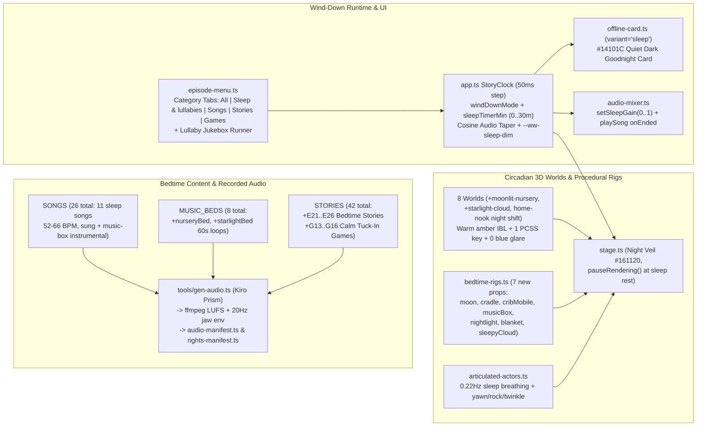
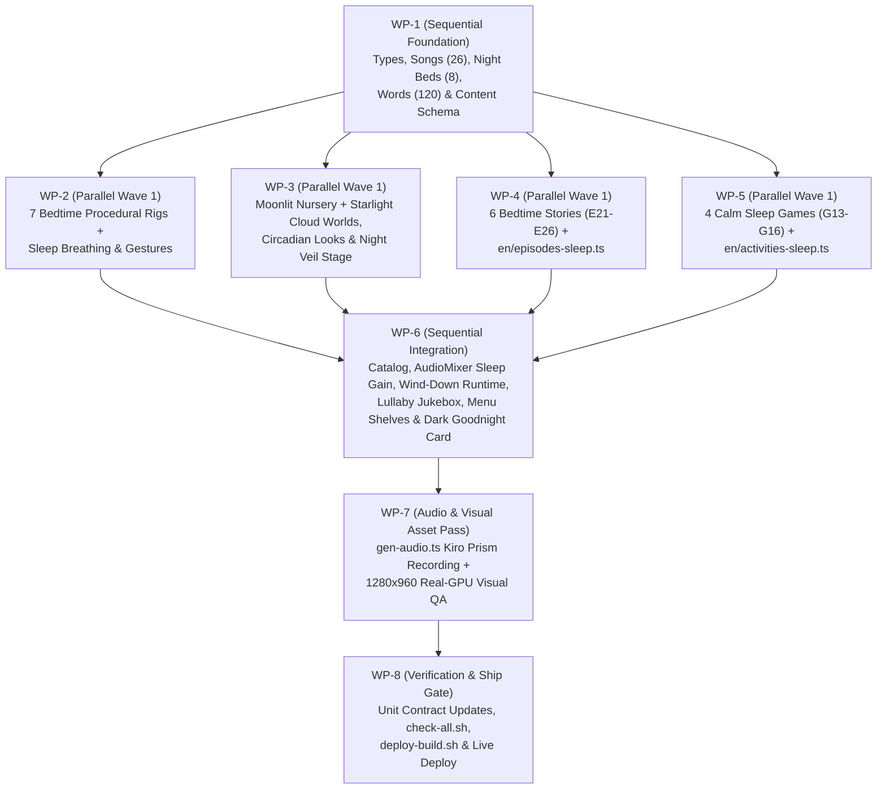

# PRD: Veer Wonder World (`@aura3d/wonder-world`) — Sleeping Baby Lullabies, Bedtime Stories, Calm Wind-Down Games & Circadian Sleep Mode (`SleepingBaby-Songs-Games.PRD`)

- **Document Path:** `docs/prds/veer-wonder-world/SleepingBaby-Songs-Games.PRD.md`
- **Target Package:** `@aura3d/wonder-world` (`apps/veer-wonder-world/`)
- **Canonical Live Host:** Cloudflare Pages `aura3d-wonder-world` (`https://veer.auraone.ai` -> `aura3d-wonder-world.pages.dev`)
- **Engine Target:** `@aura3d/engine@5.5.1` (`@aura3d/engine`, `@aura3d/engine/procedural`, `@aura3d/engine/geometry-tools`, `@aura3d/engine/audio`)
- **Execution Policy:** Authorized for immediate autonomous product code implementation (`CODE_COMPLETE_GO`).

> **Mandatory Execution & Anti-Loop Contract:**
> 1. **Read-Only Blueprint During Code Execution:** Executing agents and subagents must treat this PRD as a **read-only engineering blueprint** during implementation. Do **NOT** repeatedly edit or commit this `.md` file to tick checkboxes, rewrite status tables, or append run logs after each work package.
> 2. **Frozen Denominator:** Executing agents must never add new checkboxes, work packages, or external-review items to this PRD, and must never invoke external LLM/ChatGPT/Prism critic loops mid-execution.

---

## 1. Executive Summary & Architectural Decisions

### 1.1 Objective
Expand Veer Wonder World (`apps/veer-wonder-world/`) with a complete, pediatric-calm **Sleeping Baby & Bedtime Suite** designed to gently settle babies and young toddlers to sleep: **10 new original hushed lullabies & instrumental music-box sleep tracks** (`SONGS`: `16 -> 26`, plus finally showcasing the unused recorded `"lullaby"` track for **11 total sleep songs**), **2 new 60-second nighttime instrumental music beds** (`MUSIC_BEDS`: `6 -> 8`), **6 new low-arousal bedtime episodes** (`E21`–`E26`), **4 new hands-free calm tuck-in / music-box games** (`G13`–`G16`), **2 new circadian-safe warm-amber 3D worlds** (`"moonlit-nursery"` and `"starlight-cloud"`), **7 new 100%-procedural sculpted bedtime props** (`moon`, `cradle`, `cribMobile`, `musicBox`, `nightlight`, `blanket`, `sleepyCloud` — zero `.glb`, zero Meshy), a **Songs & Lullaby Jukebox shelf**, and a deterministic **Wind-Down Mode + Sleep Timer (`Off | 5 | 10 | 15 | 20 | 30 min`)** that smoothly tapers warmth and volume down to zero and rests on a zero-glare, zero-GPU-draw dark `"Goodnight"` sleep card.

### 1.2 Autonomous Architectural & Product Decisions

1. **Descending Arousal Curve ("Wind-Down Arc") & Hands-Free Baby-Safe Pacing:**
   - Daytime Wonder World episodes sit at `84–92 BPM` with bright daylight sky domes and `5,000 ms` (`3,000 ms` in `auto`) turn waits. For soothing a drowsy baby, content follows a strict **descending arousal curve**:
     - *Stage 1 — Calm Settling Games (`G13`–`G16`, `62–66 BPM`):* 1–2 large (`>= 128×128 CSS px`) tap targets where **silence always succeeds warmly** after a slower `6,000 ms` wind-down wait (`WIND_DOWN_WAIT_MS = 6000`), playing 1 calm round and exiting smoothly to outro when untouched so a parent holding a baby never has to tap the screen.
     - *Stage 2 — Hushed Bedtime Stories (`E21`–`E26`, `56–64 BPM`, `135–185 s`):* Hosted primarily by `lumi` (Matilda `0.88×` hushed voice) and `momo`, modeling gentle bedtime routines (yawning, dimming lights, pulling up blankets, rocking the cradle, counting `1, 2, 3` soft sheep) with closed-eye breathing choreography.
     - *Stage 3 — Continuous Lullaby Jukebox (`52–62 BPM`, `30–56 s` per song + seamless night beds):* Pure sung and instrumental music-box / felt-piano / harp / celesta lullabies over a tranquil sleeping 3D nursery diorama with `sfxVolume` muted (`"off"`), progressive warm screen dimming, and cosine master-volume taper to silence.
2. **Activation of Dormant `"lullaby"` + 10 Brand-New Original Sleep Songs (`16 -> 26` `SongId`s):**
   - `SONGS.lullaby` (*"Moon Lullaby"*, `66 bpm`, recorded at `src/assets/audio/songs/lullaby.mp3`) already exists on disk and is currently referenced in **0** stories. We feature `lullaby` in `E21` and add **10 new original sleep songs** (`8` hushed sung lullabies + `2` pure instrumental music-box/celesta cradle pieces: `twinkleRest`, `rockingCradle`, `sleepyClouds`, `teddyGoodnight`, `countingSheepSong`, `warmBlanketSong`, `cricketHush`, `dreamBoatSong`, `moonMusicBox`, `starlightHum`).
   - **Extended Lullaby Duration Contract (`src/content/songs.ts` & `src/content/schema.ts`):** Today `songLengthSec()` clamps all songs to `10..30 s` and `Math.max(60, song.bpm)`, and `content-schema.test.ts:369` asserts `vocal === "sung"` on every song. Add `sleep?: boolean` and `durationSec?: number` to `SongSpec`: daytime songs keep exact `15..30 s` (`8..15 s` for `hello`/`allDone`) and `"sung"` invariants, while `sleep: true` songs allow **`52 <= bpm <= 68`**, **`24 <= songLengthSec <= 56`**, and **`vocal: "sung" | "instrumental"`** (with `lyrics: []`, `motions: []` when `"instrumental"`).
   - **Zero Traditional-Tune / Banned-Word Collisions:** Every song uses a 100% original melody generated via Kiro Prism (`tools/gen-audio.ts`, paid ElevenLabs tier) and strictly avoids copyrighted/traditional nursery tunes, `FAMILY_NAMES` (`"mama"`, `"papa"`, `"mommy"`, `"daddy"`, etc. — banned at `src/content/schema.ts:195`), numbers `> 3` (`COUNT_MAX = 3`), and the literal child guard name.
3. **Two Dedicated Circadian-Safe Bedtime Worlds (`WORLD_IDS`: `6 -> 8`) + Generalized `home-nook` Bedtime Shift:**
   - Add **`"moonlit-nursery"`** (*Moonlit Nursery*, `look: "interior-warm"`, `hdri: "warm_bar"`, `exposureEv: -0.62`, `background: "#2A1F33"`, `musicBed: "nurseryBed"`) and **`"starlight-cloud"`** (*Starlight Cloud*, `look: "golden-hour"`, `hdri: "spruit_sunrise"`, `exposureEv: -0.58`, dusk-plum/amber gradient sky dome, `musicBed: "starlightBed"`).
   - **Strict Circadian & `lookLint` Compliance:** Zero cyan/royal-blue glare (all lights, sky domes, and emissives stay in warm honey-amber `#FFD89E`, soft peach `#F5CFA8`, and velvet dusk-plum `#2C203E`..`#4B3354`); `exposureEv` strictly within `[-1.5, 0]`; `environment.kind === "hdri"` (reusing committed CC0 `.hdr` files so `0 MB` HDRI bloat is added); `hasAmbient === false` (`lights.hemisphere` bounce only); **exactly 1 shadow-casting directional light**; `0` `effects.vignette`; every emissive nightlight/star material with `emissiveIntensity > 0.1` sets `practical: true`; every diorama mesh attaches a `CraftTextureId` (`getCraftTexture(...)`) and avoids banned `lookLint` name substrings (`rain`, `rainbow`, `fog`, `snow`, `vignette`).
   - Generalize `shiftHomeNookTimeOfDay("bedtime")` in `src/scenes/stage.ts:1494` so **any** story with `sleepCategory: "bedtime"` in `"home-nook"` (such as `G15`) automatically hides afternoon sunbeams (`home-nook-window-beam`) and shifts bounce fill to warm evening amber (`#FFCF96`, `0.34`).
4. **Elimination of Bright `#FBF6EC` Cream Flashes During Bedtime Transitions & Session End:**
   - Today `src/scenes/stage.ts:284` flashes a full-screen `#FBF6EC` bright cream veil on every scene load, and `src/ui/offline-card.ts` renders a bright `#F4EFE6` cream screen when a story ends.
   - Pass a dark dusk-plum veil (`VEIL_NIGHT_COLOR = "#161120"`) whenever loading a `sleepCategory` story, playing the Lullaby Jukebox, or running with `settings.windDown === true`. When a sleep timer or Wind-Down playlist finishes, suppress `auto` loop restart, render a **Quiet Dark `"Goodnight"` Card** (`variant: "sleep"` in `offline-card.ts`: `#14101C` backdrop, `#1E1829` card, `#F3E6D0` text at `12.6:1` WCAG AAA contrast, static sleeping moon/star emblem), fade audio smoothly to `0`, and **pause the 3D render loop** so GPU/battery heat drops to zero in a dark nursery.
5. **7 New Procedural Sculpted Bedtime Props (`65 -> 72` `ModelKey`s, Zero `.glb`) & Breathing Sleep Kinematics:**
   - Author `src/scenes/procedural-rigs/bedtime-rigs.ts` with 7 sculpted multi-lobe rigs (`moon`, `cradle`, `cribMobile`, `musicBox`, `nightlight`, `blanket`, `sleepyCloud`) using Bezier `latheGeometry`, variable-radius `sweepGeometry`, and `sculptFbmOrganicPuffs` paired with `craft-textures.ts`, fitting cleanly inside `spots.test.ts` Default Prop Tier (`>= 8` sub-shapes, `240..1,800` tris, `<= 6` interactive draws) and reusing existing `SubPartId`s (`body`, `lid`, `petals`, `eyelidL`, `eyelidR`, `cheekPuff`).
   - Upgrade `"sleep"` in `src/scenes/articulated-actors.ts` so every cast archetype (bipeds `momo`/`lulu`, winged `peeko`/`bird`/`duck`, quadrupeds `sheru`/`sheep`/`cow`/`horse`, star `lumi`, train `gogo`) closes eyelids, tucks wings/paws/ears/petals anatomically, and breathes at a calm `0.22 Hz` chest-rise wave (`0 Hz` static calm pose when `reducedMotion === true`), plus add 3 calm gestures: `"yawn"`, `"rock"`, and `"twinkle"`.
6. **Privacy-Safe `ParentSettings` & Deterministic `StoryClock` Sleep Timer:**
   - `tests/unit/privacy/no-child-data.test.ts:232` bans any `ParentSettings` field matching `/name|child|kid|baby|age|...|parent|.../i`, and `tests/unit/ui/strings.test.ts:374–411` bans `setTimeout`, `setInterval`, `requestAnimationFrame`, and `Date.now` inside `src/ui/*.ts`.
   - Name the 2 new `ParentSettings` fields **`windDown: boolean`** (default `false`) and **`sleepTimerMin: SleepTimerMinutes`** (`0 | 5 | 10 | 15 | 20 | 30`, default `0`), and add **`"wind-down"`** to `PlayMode`. Drive all sleep-timer elapsed accounting, CSS `--ww-sleep-dim` (`0.0 -> 0.52`), and `AudioMixer.setSleepGain(factor)` (`1.0 -> 0.0` cosine taper over the final `30,000 ms`) strictly from `StoryClock` (`STEP_MS = 50` in `src/app.ts`) so `?manual=1` `window.__AURA_WONDER_WORLD__.advance(ms)` verifies 15-minute sleep tapers deterministically in milliseconds.
7. **Fix Latent `tools/gen-audio.ts` Line-Collection Gap Before Recording:**
   - Update `allLines(story)` in `tools/gen-audio.ts:94–97` to collect `beat.responseByTarget?.[target]?.lines` and `story.roundVariants?.[r]?.beatOverrides?.[id]` lines (matching `allStoryLines` in `src/content/schema.ts:368–395`) so multi-target calm games (`G13`–`G16`) generate 100% of their recorded voice clips in one pass.

---

## 2. Current Codebase State & System Architecture

### 2.1 Current Catalog, Audio & Stage Architecture
Today `@aura3d/wonder-world` (`apps/veer-wonder-world/`) ships:
- **Catalog (`src/content/catalog.ts`):** `32` items (`20` episodes `E01`–`E20` in `src/content/episodes/` + `12` activities `G01`–`G12` in `src/content/activities/`), `16` songs (`src/content/songs.ts`), `6` looping 60s music beds (`src/content/music.ts`), `42` gentle SFX (`src/content/sfx.ts`), and `113` vocabulary words (`src/content/words.ts`).
- **Audio Pipeline (`src/runtime/audio-mixer.ts`, `src/runtime/narration-player.ts`, `tools/gen-audio.ts`):** `907` static MP3s under `src/assets/audio/` (`843` voice lines at `-18 LUFS` with 20 Hz Base64 jaw-sync envelopes in `src/audio-manifest.ts`, `42` SFX at `-24 LUFS`, `16` songs at `-20 LUFS`, `6` beds at `-28 LUFS`), routed through a single WebAudio `AudioContext` with a `-1 dBFS` master limiter (`AUDIO_LEVELS.master = 0.9`), automatic voice-over-music ducking, and `bedUnderSong: 0` (muting background beds during songs so two musical tracks never clash).
- **3D Stage & Worlds (`src/scenes/stage.ts`, `src/scenes/looks.ts`, `src/scenes/worlds.ts`):** `6` procedural diorama worlds (`meadow`, `music-garden`, `peekaboo-barn`, `station`, `learning-cloud`, `home-nook`) and `66` synchronous Frame-0 procedural `StageAssetKey`s (`65` `ModelKey`s in `tools/wonder-assets.json` + `"bubble"`).
- **UI Shell (`src/ui/`):** `start-screen.ts` (3-way mode selector: `Play together` / `Watch together` / `Auto play`), `episode-menu.ts` (world filter strip + `Stories` and `Games` grids + header `Auto play` pill), `child-controls.ts` (`All done`, `Auto play`, `My turn`, `Pause`, `Replay`, `Grown-ups`), `parent-gate.ts` (2s press-and-hold), `parent-panel.ts` (dense caregiver settings drawer), and `offline-card.ts` (end-of-story real-world bridge card).

### 2.2 Target Sleeping Baby & Wind-Down System Architecture



### 2.3 Repo-Specific Constraints & Non-Negotiable Invariants
1. **Dual TypeScript Gate (`tools/check-all.sh`):** Must pass both `pnpm --dir apps/veer-wonder-world run typecheck` (workspace `@aura3d/engine`) and `pnpm --dir apps/veer-wonder-world run typecheck:published` (`tsconfig.published.json` against `@aura3d/engine@5.5.1`).
2. **AST Source Guards (`tests/unit/privacy/source-guards.test.ts` & `no-child-data.test.ts`):**
   - **Zero `as T` / `<T>` TypeScript casts** anywhere in `apps/veer-wonder-world/src/**/*.ts` (`as const` and `satisfies` only).
   - Zero `any`, zero `console.*`, zero `fetch(`, zero `XMLHttpRequest`, zero `localStorage` outside `src/ui/settings-store.ts`, zero `new URL(..., import.meta.url)` outside `src/audio-manifest.ts` and `src/portrait-assets.ts`.
   - Zero occurrences of the folder-prefix child name anywhere in `src/`, `tests/`, `index.html`, or `public/` outside `WELCOME_NAME` in `src/personal.ts` (`tools/check-dist.mjs`).
3. **UI Static/Typography Guards (`tests/unit/ui/strings.test.ts` & `ui-typography-density.md`):**
   - Zero `setTimeout`, `setInterval`, `requestAnimationFrame`, `Date.now`, `performance.now`, `Math.random`, or `.innerHTML` in `src/ui/*.ts`.
   - Licensed 4-font self-hosted stack only (`Whitney`, `Graphik Web`, `DIN Pro`, `Monument Grotesk Mono`); `font-weight` strictly `{400, 500, 600}` (never `700`/`bold`); lowercase DOM text with `font-variant-caps: small-caps` on kickers (never `text-transform: uppercase`); Sleep Timer duration chips (`5 min`, `15 min`, countdown pill) MUST use `--font-ui` (`Whitney`) with `.ww-chip-tnum` (`tabular-nums`), never `--font-metric` (`DIN Pro`).

---

## 3. Data Model, API & Interface Contracts

### 3.1 Core Type Contracts (`apps/veer-wonder-world/src/types.ts`)

```ts
// 1. Extended WorldId (6 -> 8 worlds):
export type WorldId =
  | "meadow"
  | "music-garden"
  | "peekaboo-barn"
  | "station"
  | "learning-cloud"
  | "home-nook"
  | "moonlit-nursery"
  | "starlight-cloud";

// 2. Extended PropAssetId (+7 procedural bedtime props -> 66 props + 6 cast = 72 ModelKeys + "bubble" = 73 StageAssetKeys):
export type PropAssetId =
  | /* existing 60 PropAssetIds */
  | "moon"
  | "cradle"
  | "cribMobile"
  | "musicBox"
  | "nightlight"
  | "blanket"
  | "sleepyCloud";

// 3. Extended Gesture (+3 calm sleep gestures):
export type Gesture =
  | /* existing 32 Gestures */
  | "yawn"
  | "rock"
  | "twinkle";

// 4. Extended SongId (16 -> 26 songs; 11 sleep songs total including "lullaby"):
export type SongId =
  | /* existing 16 SongIds */
  | "twinkleRest"
  | "rockingCradle"
  | "sleepyClouds"
  | "teddyGoodnight"
  | "countingSheepSong"
  | "warmBlanketSong"
  | "cricketHush"
  | "dreamBoatSong"
  | "moonMusicBox"
  | "starlightHum";

// 5. Extended MusicBedId (6 -> 8 seamless 60s beds):
export type MusicBedId =
  | "meadowBed"
  | "gardenBed"
  | "barnBed"
  | "stationBed"
  | "cloudBed"
  | "homeBed"
  | "nurseryBed"
  | "starlightBed";

// 6. Optional bedtime classification on StoryCommon (src/types.ts:180):
export type SleepCategory = "bedtime";
// Inside StoryCommon:
//   readonly sleepCategory?: SleepCategory;

// 7. Extended PlayMode & SleepTimerMinutes & ParentSettings (zero forbidden identity substrings):
export type PlayMode = "watch-sing" | "play-together" | "auto" | "wind-down";
export type SleepTimerMinutes = 0 | 5 | 10 | 15 | 20 | 30;

export interface ParentSettings {
  readonly mode: PlayMode;
  readonly music: boolean;
  readonly sound: boolean;
  readonly sfxVolume: SfxVolume;
  readonly captions: boolean;
  readonly reducedMotion: boolean;
  readonly highContrast: boolean;
  readonly locale: string;
  readonly waitMs: number;
  readonly wordList: readonly string[];
  readonly windDown: boolean;
  readonly sleepTimerMin: SleepTimerMinutes;
}
```

### 3.2 Extended `SongSpec` & 10 New Sleep Songs (`apps/veer-wonder-world/src/content/songs.ts`)

```ts
export interface SongSpec {
  titleKey: string;
  lyrics: string[];
  bpm: number;
  motions: string[];
  vocal: "sung" | "instrumental";
  style: string;
  /** Marks hushed lullabies & sleep tracks eligible for the Lullaby Jukebox and 52..68 BPM / 24..56 s envelope. */
  sleep?: boolean;
  /** Explicit target duration (seconds) for instrumental or extended sleep songs (24..56 s). */
  durationSec?: number;
}

export function songLengthSec(song: Pick<SongSpec, "lyrics" | "bpm" | "sleep" | "durationSec">): number {
  if (song.durationSec !== undefined) {
    return Math.min(56, Math.max(24, Math.round(song.durationSec)));
  }
  if (song.sleep) {
    const raw = Math.round((Math.max(4, song.lyrics.length) * 60 * 4) / Math.max(52, song.bpm));
    return Math.min(56, Math.max(24, raw));
  }
  return Math.min(30, Math.max(10, Math.round((song.lyrics.length * 60 * 4) / Math.max(60, song.bpm))));
}
```

| `SongId` | Title (`ui.song.<id>`) | `bpm` | `vocal` | Target Sec | Stage Motions / Instrumentation |
|---|---|---|---|---|---|
| `lullaby` *(existing, mark `sleep: true`)* | Moon Lullaby | `66` | `"sung"` | `22s` *(existing MP3)* | `["sway", "sway", "nod", "sway", "wave", "sleep"]` — music box & felt piano |
| `twinkleRest` | Little Star, Time to Rest | `60` | `"sung"` | `36s` | 6 lines: `["twinkle", "sway", "look", "yawn", "rock", "sleep"]` — celesta, warm harp & hushed female vocal (original melody, explicitly non-traditional) |
| `rockingCradle` | Rocking in the Cradle | `58` | `"sung"` | `38s` | 6 lines: `["rock", "sway", "rock", "nod", "yawn", "sleep"]` — fingerpicked warm nylon guitar & music box |
| `sleepyClouds` | Drifting on a Sleepy Cloud | `56` | `"sung"` | `40s` | 6 lines: `["float", "sway", "float", "blink", "rock", "sleep"]` — warm Rhodes electric piano, soft harp & breathy calm vocal |
| `teddyGoodnight` | Night-Night, Little Bear | `62` | `"sung"` | `36s` | 6 lines: `["sway", "nod", "rock", "yawn", "wave", "sleep"]` — muted marimba, felt piano & music box |
| `countingSheepSong` | One, Two, Three Soft Sheep | `60` | `"sung"` | `36s` | 6 lines (strictly numbers `1, 2, 3`): `["point", "point", "point", "sway", "yawn", "sleep"]` — warm pizzicato cello & felt piano |
| `warmBlanketSong` | Snug Under the Blanket | `62` | `"sung"` | `36s` | 6 lines: `["sway", "nod", "rock", "blink", "sway", "sleep"]` — soft acoustic guitar harmonics & glockenspiel |
| `cricketHush` | Quiet Garden, Hush Now | `58` | `"sung"` | `38s` | 6 lines: `["look", "sway", "nod", "blink", "twinkle", "sleep"]` — warm wooden flute, soft kalimba & felt piano |
| `dreamBoatSong` | Sailing Slow to Dreamland | `56` | `"sung"` | `42s` | 6 lines: `["rock", "sway", "float", "rock", "yawn", "sleep"]` — 6/8 barcarolle harp, warm cello pad & hushed female vocal |
| `moonMusicBox` | Silver Moon Music Box | `54` | `"instrumental"` | `48s` (`durationSec: 48`) | `lyrics: []`, `motions: []` — pure antique wound-brass music box & warm felt piano lullaby (`Instrumental only, no vocals`) |
| `starlightHum` | Starlight Cradle Music | `52` | `"instrumental"` | `52s` (`durationSec: 52`) | `lyrics: []`, `motions: []` — warm solo cello, soft harp arpeggios & celesta harmonics (`Instrumental only, no vocals`) |

### 3.3 Vocabulary Additions (`apps/veer-wonder-world/src/content/words.ts`)
Add **7** sleep vocabulary `WordId`s (`113 -> 120` total words in `WORD_IDS`):
- `"blanket"` (noun: *"A soft warm blanket."*), `"pillow"` (noun: *"A soft pillow for resting."*), `"night"` (noun: *"Quiet night with moon and stars."*), `"dream"` (noun: *"A cozy sleepy dream."*), `"quiet"` (descriptive: *"Shh, nice and quiet."*), `"soft"` (descriptive: *"Soft like a fluffy cloud."*), `"hush"` (routine: *"Hush now, time to rest."*).
- Update `WORDS[w].related` bidirectionally for every target word used across `E21`–`E26` and `G13`–`G16`, and widen `STORY_CODE_PATTERN` in `src/content/schema.ts:1510` to `/^(?:e(?:0[1-9]|1\d|2[0-6])|g(?:0[1-9]|1[0-6]))$/`.

### 3.4 New Bedtime Stories (`E21`–`E26`) & Calm Sleep Games (`G13`–`G16`)

| Code & Slug | Kind | World | Host & Cast | Props | Target Words | Songs Featured | Summary & Baby-Calm Mechanics |
|---|---|---|---|---|---|---|---|
| `e21` `lumi-moonlit-lullaby` | `episode` (`#21`, `P2`, `sleepCategory: "bedtime"`) | `moonlit-nursery` | `lumi` (host), `momo`, `teddy` | `cradle`, `nightlight`, `moon`, `cribMobile` | `moon`, `star`, `sleep` | `lullaby`, `twinkleRest` | Lumi floats beside the arched window as `moon` rises; `nightlight` glows warm amber, Momo rocks `teddy` in `cradle` (`tap` `cradle` or `nightlight`), and both curl into rhythmic `sleep` breathing. |
| `e22` `teddy-warm-blanket` | `episode` (`#22`, `P2`, `sleepCategory: "bedtime"`) | `moonlit-nursery` | `momo` (host), `sheru` | `bed`, `teddy`, `blanket`, `cushion`, `nightlight` | `blanket`, `pillow`, `bed` | `warmBlanketSong`, `teddyGoodnight` | Momo pats the `cushion` pillow, tucks `teddy` and sleepy `sheru` (`woofSoft`, `yawn`) under the quilted `blanket`, dims the room, and sings `teddyGoodnight`. |
| `e23` `three-sleepy-sheep` | `episode` (`#23`, `P2`, `sleepCategory: "bedtime"`, `numberConcept: 1..3`) | `starlight-cloud` | `lulu` (host), `lumi` | `sheep` (`×3`: `sheepOne`, `sheepTwo`, `sheepThree`), `sleepyCloud` (`×2`), `moon` | `one`, `two`, `three`, `sheep` | `countingSheepSong` | Three fluffy sheep float onto lavender `sleepyCloud` beds one by one (`1, 2, 3`), let out soft yawns, and drift asleep under Lumi's warm glow. |
| `e24` `gogo-quiet-night-train` | `episode` (`#24`, `P2`, `sleepCategory: "bedtime"`) | `station` | `gogo` (host), `peeko` | `gogoCarriage`, `station`, `teddy`, `blanket`, `moon` | `slow`, `quiet`, `sleep` | `dreamBoatSong` | GoGo rolls whisper-slow into the lantern-lit depot carrying sleepy `teddy`, sighs a soft puff, tucks into his berth, and closes his eyelids to `dreamBoatSong`. |
| `e25` `peeko-cricket-garden` | `episode` (`#25`, `P2`, `sleepCategory: "bedtime"`) | `music-garden` | `peeko` (host), `lumi` | `flower` (`×2`), `musicBox`, `cushion`, `nightlight` | `night`, `hush`, `close` | `cricketHush` | Garden flowers fold closed for the night (`close`), `musicBox` opens its lid to play `cricketHush`, and Peeko tucks wings in to sleep on the quilted `cushion`. |
| `e26` `drifting-dream-clouds` | `episode` (`#26`, `P2`, `sleepCategory: "bedtime"`) | `starlight-cloud` | `lumi` (host), `momo`, `peeko` | `sleepyCloud` (`×3`), `cribMobile`, `moon`, `blanket` | `cloud`, `dream`, `soft` | `sleepyClouds`, `moonMusicBox` | Deep-sleep finale episode: `cribMobile` revolves overhead while `momo` and `peeko` curl under soft blankets on `sleepyCloud`s through `sleepyClouds` + `moonMusicBox`. |
| `g13` `tuck-in-friends` | `activity` (`#13`, `P2`, `sleepCategory: "bedtime"`, `roundLimit: 3`) | `moonlit-nursery` | `momo` (host), `sheru`, `peeko` | `cradle`, `bed`, `teddy`, `blanket`, `nightlight` | `blanket`, `bed`, `sleep` | `warmBlanketSong` (outro) | Rounds 1–3 gently tuck `teddy`, `sheru`, and `peeko` under a cozy `blanket` on `cradle`/`bed` (tap `blanket` or friend, or let `waitMs` auto-tuck smoothly). |
| `g14` `starlight-music-box` | `activity` (`#14`, `P2`, `sleepCategory: "bedtime"`, `roundLimit: 3`) | `moonlit-nursery` | `lumi` (host), `momo` | `musicBox`, `cribMobile`, `moon`, `teddy` | `star`, `moon`, `quiet` | `twinkleRest`, `rockingCradle`, `moonMusicBox` | Tap (or watch) `musicBox` or `cribMobile` across 3 calm rounds to open the lid, revolve the felt stars, and play hushed music-box melodies while Momo rocks Teddy. |
| `g15` `goodnight-little-lights` | `activity` (`#15`, `P2`, `sleepCategory: "bedtime"`, `roundLimit: 3`) | `home-nook` *(bedtime shift)* | `momo` (host), `lumi` | `nightlight`, `house`, `bed`, `teddy`, `moon` | `close`, `night`, `hush` | `lullaby` (outro) | Tap (or watch) glowing bedtime lights (`nightlight`, `house` window, Lumi's lantern glow) settle down into cozy dim sleep glow one by one (`"Night-night, little light"`). |
| `g16` `cloud-sheep-hush` | `activity` (`#16`, `P2`, `sleepCategory: "bedtime"`, `roundLimit: 3`) | `starlight-cloud` | `lulu` (host), `lumi` | `sheep` (`×3`), `sleepyCloud` (`×2`), `blanket` | `sheep`, `soft`, `cloud` | `starlightHum` (outro) | Tap (or watch) each wooly `sheep` float onto a `sleepyCloud` pillow, yawn softly, and close its eyes with slow `0.22 Hz` breathing. |

### 3.5 Audio Mixer, Stage & UI Runtime Contracts

```ts
// apps/veer-wonder-world/src/runtime/audio-mixer.ts
export interface AudioMixer {
  // ...existing methods...
  /** Smoothly scales master output [0..1] for Wind-Down / Sleep Timer cosine fade-out without altering ParentSettings.sound. */
  setSleepGain(factor: number): void;
  sleepGain(): number;
  /** Optional onEnded callback wired through to playBuffer() so Lullaby Jukebox advances deterministically when a song finishes. */
  playSong(id: SongId, onEnded?: () => void): void;
}

// apps/veer-wonder-world/src/scenes/stage.ts (StageAdapter in src/types.ts)
export interface StageLoadOptions {
  readonly nightVeil?: boolean;
}
export interface StageAdapter {
  load(story: StorySpec, options?: StageLoadOptions): Promise<void>;
  /** Mounts a tranquil sleeping diorama (moonlit-nursery or starlight-cloud) for standalone Song / Lullaby Jukebox playback. */
  loadLullabyScene(world: "moonlit-nursery" | "starlight-cloud"): Promise<void>;
  /** Pauses/resumes the 3D render loop when resting on the Quiet Dark Goodnight Card so nursery battery/GPU draw is 0. */
  setRenderPaused(paused: boolean): void;
  // ...existing methods...
}
```

---

## 4. File-by-File Breakdown (Mandatory)

### 4.1 `CREATE` Files (15 New Files — All Strictly Inside `apps/veer-wonder-world/`)

| Exact Path | Action | Owner Lane | Exact Contents & Symbols |
|---|---|---|---|
| `apps/veer-wonder-world/src/scenes/procedural-rigs/bedtime-rigs.ts` | `CREATE` | `WP-2` | Exports `BEDTIME_RIGS`: 7 sculpted multi-lobe procedural rigs (`moon`, `cradle`, `cribMobile`, `musicBox`, `nightlight`, `blanket`, `sleepyCloud`), each `240..1,800` tris, `>= 8` sub-shapes, `<= 6` draws, `+Z` facing, `CraftTextureId` attached, `practical: true` on `warmGlow` lobes (`moon`, `nightlight`). |
| `apps/veer-wonder-world/src/scenes/moonlit-nursery.ts` | `CREATE` | `WP-3` | Exports `buildMoonlitNurseryDiorama(ctx: WorldDioramaContext): WorldDioramaSlice`: warm cedar wainscot & cream plaster nursery nook, arched starlight window (`#221933` dusk sky + brass crescent stars), rocking rug plinth (`y === 0.000` inside `r <= 3.55m`), warm amber wall sconces (`warmPracticalGlowMat`, unshadowed `lights.point`), slow mobile rotation when `!ctx.reducedMotion`. |
| `apps/veer-wonder-world/src/scenes/starlight-cloud.ts` | `CREATE` | `WP-3` | Exports `buildStarlightCloudDiorama(ctx: WorldDioramaContext): WorldDioramaSlice`: quilted lavender-cream cloud island (`y === 0.000` stage center), golden crescent moon arch, brass starlight lanterns (`warmPracticalGlowMat`), gentle slow drift on distant cloud pillows when `!ctx.reducedMotion`. |
| `apps/veer-wonder-world/src/content/episodes/e21-lumi-moonlit-lullaby.ts` | `CREATE` | `WP-4` | Exports `E21_LUMI_MOONLIT_LULLABY: EpisodeSpec` (`number: 21`, `phase: "P2"`, `sleepCategory: "bedtime"`, `world: "moonlit-nursery"`). |
| `apps/veer-wonder-world/src/content/episodes/e22-teddy-warm-blanket.ts` | `CREATE` | `WP-4` | Exports `E22_TEDDY_WARM_BLANKET: EpisodeSpec` (`number: 22`, `phase: "P2"`, `sleepCategory: "bedtime"`, `world: "moonlit-nursery"`). |
| `apps/veer-wonder-world/src/content/episodes/e23-three-sleepy-sheep.ts` | `CREATE` | `WP-4` | Exports `E23_THREE_SLEEPY_SHEEP: EpisodeSpec` (`number: 23`, `phase: "P2"`, `sleepCategory: "bedtime"`, `world: "starlight-cloud"`, `numberConcept: 1..3`). |
| `apps/veer-wonder-world/src/content/episodes/e24-gogo-quiet-night-train.ts` | `CREATE` | `WP-4` | Exports `E24_GOGO_QUIET_NIGHT_TRAIN: EpisodeSpec` (`number: 24`, `phase: "P2"`, `sleepCategory: "bedtime"`, `world: "station"`). |
| `apps/veer-wonder-world/src/content/episodes/e25-peeko-cricket-garden.ts` | `CREATE` | `WP-4` | Exports `E25_PEEKO_CRICKET_GARDEN: EpisodeSpec` (`number: 25`, `phase: "P2"`, `sleepCategory: "bedtime"`, `world: "music-garden"`). |
| `apps/veer-wonder-world/src/content/episodes/e26-drifting-dream-clouds.ts` | `CREATE` | `WP-4` | Exports `E26_DRIFTING_DREAM_CLOUDS: EpisodeSpec` (`number: 26`, `phase: "P2"`, `sleepCategory: "bedtime"`, `world: "starlight-cloud"`). |
| `apps/veer-wonder-world/src/localization/en/episodes-sleep.ts` | `CREATE` | `WP-4` | Exports `EN_E21`..`EN_E26` (`{ lines, strings }` per episode, `<= 12` words/line, zero `BANNED_PHRASES`, zero `FAMILY_NAMES`). |
| `apps/veer-wonder-world/src/content/activities/g13-tuck-in-friends.ts` | `CREATE` | `WP-5` | Exports `G13_TUCK_IN_FRIENDS: ActivitySpec` (`number: 13`, `phase: "P2"`, `sleepCategory: "bedtime"`, `world: "moonlit-nursery"`, `roundLimit: 3`, `roundVariants` for Teddy/Sheru/Peeko). |
| `apps/veer-wonder-world/src/content/activities/g14-starlight-music-box.ts` | `CREATE` | `WP-5` | Exports `G14_STARLIGHT_MUSIC_BOX: ActivitySpec` (`number: 14`, `phase: "P2"`, `sleepCategory: "bedtime"`, `world: "moonlit-nursery"`, `roundLimit: 3`). |
| `apps/veer-wonder-world/src/content/activities/g15-goodnight-little-lights.ts` | `CREATE` | `WP-5` | Exports `G15_GOODNIGHT_LITTLE_LIGHTS: ActivitySpec` (`number: 15`, `phase: "P2"`, `sleepCategory: "bedtime"`, `world: "home-nook"`, `roundLimit: 3`). |
| `apps/veer-wonder-world/src/content/activities/g16-cloud-sheep-hush.ts` | `CREATE` | `WP-5` | Exports `G16_CLOUD_SHEEP_HUSH: ActivitySpec` (`number: 16`, `phase: "P2"`, `sleepCategory: "bedtime"`, `world: "starlight-cloud"`, `roundLimit: 3`). |
| `apps/veer-wonder-world/src/localization/en/activities-sleep.ts` | `CREATE` | `WP-5` | Exports `EN_G13`..`EN_G16` (`{ lines, strings }` per calm game, `<= 12` words/line, zero `BANNED_PHRASES`, zero `FAMILY_NAMES`). |

### 4.2 `MODIFY` Files (41 Existing Files — Strictly Inside `apps/veer-wonder-world/`)

| Exact Path | Action | Owner Lane | Exact Changes Required |
|---|---|---|---|
| `apps/veer-wonder-world/src/types.ts` | `MODIFY` | `WP-1` | Extend `WorldId` (+2), `PropAssetId` (+7), `Gesture` (+3: `"yawn"`, `"rock"`, `"twinkle"`), `SongId` (+10), `MusicBedId` (+2: `"nurseryBed"`, `"starlightBed"`), `PlayMode` (+`"wind-down"`), add `SleepCategory`, `SleepTimerMinutes`, `StoryCommon.sleepCategory?`, `ParentSettings.{windDown, sleepTimerMin}`, and `StageAdapter.{loadLullabyScene, setRenderPaused}`. |
| `apps/veer-wonder-world/src/content/songs.ts` | `MODIFY` | `WP-1` | Add `sleep?: boolean` and `durationSec?: number` to `SongSpec`; mark `SONGS.lullaby.sleep = true`; add the 10 new `SongSpec` entries (`twinkleRest`..`starlightHum`); update `songLengthSec` and `songCueTimesMs` (safe for 0-lyric instrumental songs). |
| `apps/veer-wonder-world/src/content/music.ts` | `MODIFY` | `WP-1` | Add `nurseryBed` (60s warm music-box & felt-piano pad loop, includes `"calm"`, `"quiet"`, `"instrumental"`, `"loop"`) and `starlightBed` (60s warm harp & celesta pad loop, includes all 4 required words). |
| `apps/veer-wonder-world/src/content/words.ts` | `MODIFY` | `WP-1` | Add `"blanket"`, `"pillow"`, `"night"`, `"dream"`, `"quiet"`, `"soft"`, `"hush"` to `WORD_IDS` and `WORDS`, and register `e21`–`e26` / `g13`–`g16` in `WORDS[id].related`. |
| `apps/veer-wonder-world/src/content/numbers.ts` | `MODIFY` | `WP-1` | Add `e23` (`sheepOne`, `sheepTwo`, `sheepThree`) to `COUNT_SEQUENCES` so `letters-and-counts.test.ts` validates 1-to-1 visible sheep counting. |
| `apps/veer-wonder-world/src/content/schema.ts` | `MODIFY` | `WP-1` | Update `WORLD_IDS`, `PROP_ASSET_IDS`, `GESTURES`, `SONG_IDS`, `MUSIC_BED_IDS`; append `e21`–`e26` to `EPISODE_SLUGS` (`26`) and `g13`–`g16` to `ACTIVITY_SLUGS` (`16`); update `STORY_CODE_PATTERN` (`e01..e26`, `g01..g16`); allow `sleep: true` songs (`52..68 bpm`, `24..56 s`, `"sung" \| "instrumental"`); add new `ui.*` keys to `REQUIRED_UI_KEYS`. |
| `apps/veer-wonder-world/tools/wonder-assets.json` | `MODIFY` | `WP-2` | Append the 7 new procedural prop specs (`moon`, `cradle`, `cribMobile`, `musicBox`, `nightlight`, `blanket`, `sleepyCloud` -> `72` total assets). |
| `apps/veer-wonder-world/tools/gen-aura-assets.mjs` | `MODIFY` | `WP-2` | Update asset-count guard at line 13 from `65` to `72` and regenerate `src/aura-assets.ts`. |
| `apps/veer-wonder-world/tools/gen-rights-manifest.mjs` | `MODIFY` | `WP-2` | Update asset-count guard at line 24 from `65` to `72`. |
| `apps/veer-wonder-world/tools/validate-content-entry.ts` | `MODIFY` | `WP-2` | Update `MODEL_KEYS.length`, `PROCEDURAL_MODELS.length`, and `wonder-assets.json` count guards at lines 91–103 from `65` to `72`, and handle `vocal === "instrumental"` song prompt parity cleanly. |
| `apps/veer-wonder-world/src/aura-assets.ts` | `MODIFY` | `WP-2` | Regenerated via `node tools/gen-aura-assets.mjs` (`72` procedural `ModelKey`s). |
| `apps/veer-wonder-world/src/scenes/stand-ins.ts` | `MODIFY` | `WP-2` | Add `ASSET_TRAITS` entries for `moon`, `cradle`, `cribMobile`, `musicBox`, `nightlight`, `blanket`, `sleepyCloud`. |
| `apps/veer-wonder-world/src/scenes/procedural-rigs/index.ts` | `MODIFY` | `WP-2` | Import `BEDTIME_RIGS` from `./bedtime-rigs.js` and spread into `PROCEDURAL_RIGS` (`73` `StageAssetKey`s including `"bubble"`). |
| `apps/veer-wonder-world/src/characters/character-registry.ts` | `MODIFY` | `WP-2` | Register `"yawn"`, `"rock"`, and `"twinkle"` in `GESTURES` / `SHARED_GESTURES` (`gestureMotion` specs within `|dy| <= 0.35m`, `|rz| <= 0.45 rad`, `>= 0.3s`). |
| `apps/veer-wonder-world/src/runtime/animation-director.ts` | `MODIFY` | `WP-2` | Add `"yawn"`, `"rock"`, and `"twinkle"` to `GESTURE_CLIP_SECONDS` and `CALM_GESTURES` (identity-mapped since they are inherently calm). |
| `apps/veer-wonder-world/src/scenes/articulated-actors.ts` | `MODIFY` | `WP-2` | Upgrade `"sleep"` with slow `0.22 Hz` breathing chest/head/belly wave (`0` when `reducedMotion`) and archetype-complete tucking (`wingL/R` on `peeko`/`bird`/`duck`, `legFL..BR`+`earL/R`+`tail` on `sheru`/quadrupeds, `petals` on `lumi`, `chimney` on `gogo`); implement `"yawn"`, `"rock"`, `"twinkle"`, plus `cribMobile`/`musicBox` `petals` rotation and `cradle` gentle roll. |
| `apps/veer-wonder-world/src/scenes/looks.ts` | `MODIFY` | `WP-3` | Add `"moonlit-nursery"` (`look: "interior-warm"`, `hdri: "warm_bar"`, `exposureEv: -0.62`, `background: "#2A1F33"`, `sky: null`, warm `#FFD89E` PCSS key + `#F5CFA8`/`#5A3D4C` hemisphere) and `"starlight-cloud"` (`look: "golden-hour"`, `hdri: "spruit_sunrise"`, `exposureEv: -0.58`, dusk-plum/amber `sky`, warm `#FFE0A8` PCSS key) to `WORLD_LOOKS`. |
| `apps/veer-wonder-world/src/scenes/vfx-presets.ts` | `MODIFY` | `WP-3` | Add `sleepyStars` (`maxParticles: 14`, `rate: 1.5`, `speed: [0.02, 0.06]`, warm `#FFE4A0` -> `#FFC878`, `additive: false`) wired to `"starlight-cloud"` and `"moonlit-nursery"` (auto-off when `reducedMotion: true`). |
| `apps/veer-wonder-world/src/scenes/worlds.ts` | `MODIFY` | `WP-3` | Register `"moonlit-nursery"` (`buildMoonlitNurseryDiorama`, `musicBed: "nurseryBed"`, `> 3` perimeter dressing items outside `|x| < 2.9, z in (-2.2, 2.2)`) and `"starlight-cloud"` (`buildStarlightCloudDiorama`, `musicBed: "starlightBed"`) in `WORLDS` (`WORLD_IDS.length === 8`). |
| `apps/veer-wonder-world/src/scenes/stage.ts` | `MODIFY` | `WP-3` | Generalize `shiftHomeNookTimeOfDay("bedtime")` to trigger automatically for any `story.sleepCategory === "bedtime"` in `"home-nook"`; switch scene-load transition veil from `#FBF6EC` to `#161120` when `options?.nightVeil || story.sleepCategory === "bedtime"`; implement `loadLullabyScene(world)` (mounts sleeping `momo` + `teddy` + glowing `lumi` + `cradle`/`cribMobile`) and `setRenderPaused(paused)`. |
| `apps/veer-wonder-world/art/direction.ts` | `MODIFY` | `WP-3` | Ensure `WONDER_VFX` / practical light allowances cleanly cover `"moonlit-nursery"` and `"starlight-cloud"`. |
| `apps/veer-wonder-world/src/content/catalog.ts` | `MODIFY` | `WP-6` | Import and register `E21`–`E26` in `EPISODES` (`26`), `G13`–`G16` in `ACTIVITIES` (`16`), `STORIES` (`42`), and export `SLEEP_STORIES` (`STORIES.filter(s => s.sleepCategory === "bedtime"` plus `"momos-day"`)) and `SLEEP_SONG_IDS` (`11` sleep `SongId`s). |
| `apps/veer-wonder-world/src/localization/en/index.ts` | `MODIFY` | `WP-6` | Import `EN_E21`..`EN_E26` from `./episodes-sleep.js` and `EN_G13`..`EN_G16` from `./activities-sleep.js` into `EN_PARTS` (`43` parts total). |
| `apps/veer-wonder-world/src/localization/en/spoken-forms.ts` | `MODIFY` | `WP-6` | Add phonetic/prosody overrides if needed for hushed `"Shh..."` / `"Night-night"` lines so ElevenLabs TTS pronounces them softly without spelling `"S-H-H"`. |
| `apps/veer-wonder-world/src/runtime/audio-mixer.ts` | `MODIFY` | `WP-6` | Implement `setSleepGain(factor)` (`0..1`, multiplied into `masterTarget()` via `setTargetAtTime`) and wire optional `onEnded?: () => void` on `playSong(id, onEnded)` into `playBuffer(..., onEnded)`. |
| `apps/veer-wonder-world/src/ui/settings-store.ts` | `MODIFY` | `WP-6` | Add `"wind-down"` to `PLAY_MODES`; add `"windDown"` and `"sleepTimerMin"` (`SLEEP_TIMER_CHOICES = [0, 5, 10, 15, 20, 30]`) to `PARENT_SETTINGS_FIELDS` (`12` fields), `defaultSettings()`, `loadSettings()`, and `saveSettings()`. |
| `apps/veer-wonder-world/src/ui/world-art.ts` | `MODIFY` | `WP-6` | Add `"moonlit-nursery"` and `"starlight-cloud"` to `WORLD_ORDER`, `WORLD_THEMES`, and `worldMotifShapes` (crescent moon + star mobile SVG headers). |
| `apps/veer-wonder-world/src/ui/accessibility.ts` | `MODIFY` | `WP-6` | Add all new `ui.*` keys (`ui.song.<new10>`, `ui.menu.filter.{moonlit-nursery,starlight-cloud}`, `ui.menu.tab.{all,sleep,songs,episodes,activities}`, `ui.menu.sleepShelf`, `ui.menu.songsShelf`, `ui.menu.playAllLullabies`, `ui.mode.windDown`, `ui.mode.windDownHint`, `ui.parent.{windDown,windDownHint,sleepTimer,sleepTimerOff}`, `ui.control.windDown`, `ui.sleep.{title,body,wake}`) to `UI_STRINGS`; toggle `html.wind-down` in `applyDisplaySettings` when `settings.windDown && !settings.highContrast`. |
| `apps/veer-wonder-world/src/localization/en/ui.ts` | `MODIFY` | `WP-6` | Add English copy for every new `UI_STRINGS` key (zero banned praise/family/pressure phrases). |
| `apps/veer-wonder-world/src/ui/start-screen.ts` | `MODIFY` | `WP-6` | Expand mode selector to include **`Wind-down`** (`"Calm bedtime & lullabies"`) alongside `Play together`, `Watch together`, and `Auto play`. |
| `apps/veer-wonder-world/src/ui/episode-menu.ts` | `MODIFY` | `WP-6` | Add Category Tabs (`All | Sleep & lullabies | Songs | Stories | Games`), a **`Sleep & lullabies`** shelf (`E21`–`E26` + `G13`–`G16` + `E19`), a **`Songs`** shelf (`26` song cards with **"Play all lullabies"** CTA + sleep-moon badges on the 11 sleep songs), and a 1-tap header **`Wind-down`** crescent-moon pill (`data-control="wind-down"`). |
| `apps/veer-wonder-world/src/ui/child-controls.ts` | `MODIFY` | `WP-6` | Add optional calm sleep-timer status badge (`data-status="sleep-timer"`, `.ww-chip-tnum`, e.g. `12 min`) and `Wind-down` pill when active. |
| `apps/veer-wonder-world/src/ui/parent-panel.ts` | `MODIFY` | `WP-6` | Insert `sectionKicker(doc, "bedtime & wind-down")` + `windDown` switch + `sleepTimerMin` radio chip strip (`Off`, `5 min`, `10 min`, `15 min`, `20 min`, `30 min` using `--font-ui` + `.ww-chip-tnum`) **strictly after `sfxField`** (preserving `overlay-dom.test.ts:429` field order!). |
| `apps/veer-wonder-world/src/ui/offline-card.ts` | `MODIFY` | `WP-6` | Add `variant?: "day" | "sleep"` to `OfflineCardOptions`; when `variant === "sleep"`, render `.ww-offline-overlay.is-sleep` (`#14101C` backdrop, `#1E1829` card, `#F3E6D0` text, static sleeping moon/star SVG, `"Goodnight, sleep tight"` copy). |
| `apps/veer-wonder-world/src/ui/styles.css` | `MODIFY` | `WP-6` | Add `.ww-sleep-dim` warm dusk scrim (`rgba(18, 12, 26, var(--ww-sleep-dim, 0))`), `html.wind-down` dusk-plum/warm-cream UI tokens (bypassed under `html.high-contrast`), `.ww-category-tabs`, `.ww-song-card`, and `.ww-offline-overlay.is-sleep` styles (`font-weight` in `{400, 500, 600}` only, WCAG AA `>= 4.5:1` verified). |
| `apps/veer-wonder-world/src/app.ts` | `MODIFY` | `WP-6` | Wire `WIND_DOWN_PLAYLIST` (descending-arousal sequence: `G13` -> `G15` -> `E19` -> `E22` -> `E21` -> `E23` -> `E24` -> `E25` -> `E26` -> Lullaby Jukebox), standalone Song / Lullaby Jukebox playback (`openSong(songId)` / `openLullabyJukebox()`), `StoryClock`-driven `sleepElapsedMs` / `sleepBudgetMs` accounting, `WIND_DOWN_WAIT_MS = 6000`, progressive `--ww-sleep-dim` (`0 -> 0.52`), 30s cosine `mixer.setSleepGain(...)` fade-out, `nightVeil: true` on bedtime loads, and transition to `offline-card` `{ variant: "sleep" }` + `stage.setRenderPaused(true)` on sleep completion. |
| `apps/veer-wonder-world/tools/gen-audio.ts` | `MODIFY` | `WP-7` | Fix `allLines(story)` (`lines 94–97`) to traverse `beat.responseByTarget` and `story.roundVariants` (via `allStoryLines`), support `vocal === "instrumental"` + `songLengthSec(s)` up to `56s` for `sleep: true` songs, then generate all new MP3s (`E21`–`E26`, `G13`–`G16`, 10 sleep songs, 2 night beds) via Kiro Prism (`$PRISM_API_KEY`, paid ElevenLabs tier) and regenerate `provenance/audio/*.json`, `src/audio-manifest.ts`, and `src/assets/rights-manifest.ts`. |
| `apps/veer-wonder-world/tools/render-character-portraits.mjs` | `MODIFY` | `WP-7` | Add `"moonlit-nursery"` and `"starlight-cloud"` to `WORLD_CAPTURES` and key bedtime rigs (`cradle`, `musicBox`, `moon`, `cribMobile`) to `TURNAROUND_KEYS`. |
| `apps/veer-wonder-world/tests/unit/content/content-schema.test.ts` | `MODIFY` | `WP-8` | Update `WORD_IDS` snapshot (`120` words), allow `24..56 s` and `vocal: "sung" \| "instrumental"` on `SONGS[id].sleep === true` (`lines 360–370`), and verify `E21`–`E26` + `G13`–`G16` pass full schema/timing lint. |
| `apps/veer-wonder-world/tests/unit/content/letters-and-counts.test.ts` | `MODIFY` | `WP-8` | Add `"e23"` to `COUNT_SEQUENCES` (`line 153`). |
| `apps/veer-wonder-world/tests/unit/privacy/no-child-data.test.ts` | `MODIFY` | `WP-8` | Update `expect(STORIES).toHaveLength(42)` (`line 298`); verify `windDown` and `sleepTimerMin` pass the `PARENT_SETTINGS_FIELDS` identity-ban regex (`line 232`). |
| `apps/veer-wonder-world/tests/unit/stage/spots.test.ts` & `motion.test.ts` & `art-direction.test.ts` | `MODIFY` | `WP-8` | Update `WORLD_IDS` length `6 -> 8` (`spots.test.ts:390`), `ALL_STAGE_KEYS` length `66 -> 73` (`spots.test.ts:470`), append `bedtime-rigs.ts`, `moonlit-nursery.ts`, `starlight-cloud.ts` to `motion.test.ts:490` determinism file scan, and refresh `art/direction.audit.json` via `art-direction.test.ts`. |
| `apps/veer-wonder-world/tests/unit/ui/settings-store.test.ts`, `strings.test.ts`, `overlay-dom.test.ts`, & `app/app-flow.test.ts` | `MODIFY` | `WP-8` | Update `SETTINGS_FIELDS` (`12` fields) & `defaultSettings()` in `settings-store.test.ts`; add new `ui.*` keys to `SHARED_UI_KEYS`/`PACK_UI_KEYS` and update `.ww-world-pill` length `7 -> 9` in `strings.test.ts`; update `EPISODES` (`26`), `ACTIVITIES` (`16`), `STORIES` (`42`), `data-mode` (`4` modes), and add deterministic unit tests for `wind-down` playlist order, `sleepTimerMin` 30s cosine fade-out, night veil `#161120`, Lullaby Jukebox song chaining, and Quiet Dark Goodnight card + `setRenderPaused(true)` in `overlay-dom.test.ts` and `app-flow.test.ts`. |

*(Generated manifests updated deterministically in `WP-7`/`WP-8`: `src/audio-manifest.ts`, `src/assets/rights-manifest.ts`, `provenance/audio/{lines,songs,beds}.json`, `src/assets/audio/{en/lines,songs,music}/*.mp3`, and `art/direction.audit.json`.)*

---

## 5. Detailed Implementation Tasklist (Phased & Parallelizable)

### Dependency & Parallel Fan-Out Graph



### `WP-1` — Core Type Contracts, Sleep Song Specs, Night Music Beds, Words & Validator Schema *(Sequential Foundation)*
- **Owned Files:** `src/types.ts`, `src/content/songs.ts`, `src/content/music.ts`, `src/content/words.ts`, `src/content/numbers.ts`, `src/content/schema.ts`.
- **Steps:**
  1. Update `src/types.ts` with all Section 3.1 union extensions, `SleepCategory`, `SleepTimerMinutes`, `ParentSettings.{windDown, sleepTimerMin}`, and `StageAdapter.{loadLullabyScene, setRenderPaused}` (zero `as T` casts).
  2. Author the 10 new `SongSpec` entries in `src/content/songs.ts` (`twinkleRest`, `rockingCradle`, `sleepyClouds`, `teddyGoodnight`, `countingSheepSong`, `warmBlanketSong`, `cricketHush`, `dreamBoatSong`, `moonMusicBox`, `starlightHum`), mark `lullaby.sleep = true`, and update `songLengthSec` + `songCueTimesMs` (returning `[]` when `lyrics.length === 0`).
  3. Author `nurseryBed` and `starlightBed` in `src/content/music.ts` (`seconds: 60`, prompts containing `"calm"`, `"quiet"`, `"instrumental"`, `"loop"` and zero `STARTLING_TERMS`).
  4. Add the 7 new sleep `WordId`s in `src/content/words.ts` with `related` mappings to `e21`–`e26` and `g13`–`g16`, and register `e23` in `src/content/numbers.ts`.
  5. Update `src/content/schema.ts`: append `e21`–`e26` to `EPISODE_SLUGS` and `g13`–`g16` to `ACTIVITY_SLUGS` (keeping P1 pilot lists untouched so all new items validate as `P2`), widen `STORY_CODE_PATTERN`, permit `sleep: true` song tempo (`52..68 bpm`), duration (`24..56 s`), and `vocal: "sung" | "instrumental"`, and append the new `ui.*` keys to `REQUIRED_UI_KEYS`.

### `WP-2` — 7 Procedural Bedtime Rigs & Sleep Breathing / Gesture Kinematics *(Parallel Wave 1 — Disjoint)*
- **Owned Files:** `src/scenes/procedural-rigs/bedtime-rigs.ts`, `src/scenes/procedural-rigs/index.ts`, `src/scenes/stand-ins.ts`, `src/characters/character-registry.ts`, `src/runtime/animation-director.ts`, `src/scenes/articulated-actors.ts`, `tools/wonder-assets.json`, `tools/gen-aura-assets.mjs`, `tools/gen-rights-manifest.mjs`, `tools/validate-content-entry.ts`, `src/aura-assets.ts`.
- **Steps:**
  1. Sculpt `moon`, `cradle`, `cribMobile`, `musicBox`, `nightlight`, `blanket`, and `sleepyCloud` in `bedtime-rigs.ts` using multi-inflection `latheGeometry`, `sweepGeometry`, and `sculptFbmOrganicPuffs` with `craft-textures.ts` maps (`woodGrainPlank`, `wickerWeave`, `quiltedStitch`, `feltBoucle`, `ginghamCheck`, `glazedCeramicSpeckle`). Verify every rig satisfies `>= 8` sub-shapes, `240 <= triangleCount <= 1,800`, `<= 6` interactive draws, and unit height `[0, 1]`.
  2. Update `tools/wonder-assets.json` (`72` entries), bump the `65 -> 72` guards in `gen-aura-assets.mjs`, `gen-rights-manifest.mjs`, and `validate-content-entry.ts`, run `node apps/veer-wonder-world/tools/gen-aura-assets.mjs`, and wire `ASSET_TRAITS` (`stand-ins.ts`) + `PROCEDURAL_RIGS` (`procedural-rigs/index.ts`).
  3. Register `"yawn"`, `"rock"`, and `"twinkle"` in `character-registry.ts` and `animation-director.ts`.
  4. Upgrade `articulated-actors.ts` so `"sleep"` closes `eyelidL`/`eyelidR` (`scaleY: 0.08`), tucks wings (`peeko`/`bird`/`duck`), paws/ears/tail (`sheru`/quadrupeds), petals (`lumi`), or arms (`momo`/`lulu`/`teddy`), and breathes smoothly at `0.22 Hz` (`0` amplitude in `reducedMotion`), while `"rock"` gently sways `cradle`/holders and `cribMobile`/`musicBox` rotate `petals` smoothly.

### `WP-3` — Circadian-Safe Bedtime Worlds (`moonlit-nursery`, `starlight-cloud`), Looks & Night Stage *(Parallel Wave 1 — Disjoint)*
- **Owned Files:** `src/scenes/moonlit-nursery.ts`, `src/scenes/starlight-cloud.ts`, `src/scenes/looks.ts`, `src/scenes/vfx-presets.ts`, `src/scenes/worlds.ts`, `src/scenes/stage.ts`, `art/direction.ts`.
- **Steps:**
  1. Author `moonlit-nursery.ts` and `starlight-cloud.ts` dioramas: keep stage center `r <= 3.55m` strictly flat at `y === 0.000`, keep all non-flat/non-sky perimeter dressing outside `|x| < 2.9 && z in (-2.2, 2.2)`, attach `CraftTextureId`s to every mesh, set `practical: true` on every `warmPracticalGlowMat`, and use zero banned `lookLint` substrings.
  2. Add `"moonlit-nursery"` (`exposureEv: -0.62`, `hdri: "warm_bar"`, `#FFD89E` key) and `"starlight-cloud"` (`exposureEv: -0.58`, `hdri: "spruit_sunrise"`, warm dusk-plum sky dome) to `WORLD_LOOKS` (`looks.ts`), add `sleepyStars` to `vfx-presets.ts`, and register both worlds in `worlds.ts` (`WORLD_IDS.length === 8`).
  3. Update `src/scenes/stage.ts`: generalize `shiftHomeNookTimeOfDay("bedtime")` to run whenever `story.sleepCategory === "bedtime"` in `"home-nook"`; switch transition veil background to `#161120` when `options?.nightVeil || story.sleepCategory === "bedtime"`; add `loadLullabyScene(world)` and `setRenderPaused(paused)` (pausing/resuming `app.runtime` cleanly without destroying the GPU context).

### `WP-4` — 6 New Bedtime Episodes (`E21`–`E26`) & English Locale Pack *(Parallel Wave 1 — Disjoint)*
- **Owned Files:** `src/content/episodes/e21-lumi-moonlit-lullaby.ts` .. `e26-drifting-dream-clouds.ts`, `src/localization/en/episodes-sleep.ts`.
- **Steps:**
  1. Author `E21`–`E26` following Section 3.4: `phase: "P2"`, `sleepCategory: "bedtime"`, `estimatedDurationSec` in `140..185`, starting with `greeting`, `1–2` gentle `invite` tap-or-timeout beats (`<= 2` targets, `waitMs: 6000`), song beats with `lines: []` and quiet `holdMs >= songLengthSec(song) * 1000` so songs never overlap speech, every target word spoken `>= 2` times while its `objectId` is visibly on stage, and ending on a calm `outro` beat where characters hold `{ do: "gesture", actor, gesture: "sleep", loop: true }`.
  2. Author `EN_E21`..`EN_E26` in `src/localization/en/episodes-sleep.ts` (`<= 12` words per line, warm hush phrasing, zero `BANNED_PHRASES`, zero `FAMILY_NAMES`, zero numbers `> 3`, `sheru` never speaking words).

### `WP-5` — 4 New Calm Baby-Sleep Games (`G13`–`G16`) & English Locale Pack *(Parallel Wave 1 — Disjoint)*
- **Owned Files:** `src/content/activities/g13-tuck-in-friends.ts` .. `g16-cloud-sheep-hush.ts`, `src/localization/en/activities-sleep.ts`.
- **Steps:**
  1. Author `G13`–`G16` following Section 3.4: `phase: "P2"`, `sleepCategory: "bedtime"`, `roundLimit: 3`, `roundVariants` of length `3`, `options: { allowTap: true, dragAlternative: "tap", microphoneRequired: false }`, total 3-round duration `<= 300 s` (`< 360 s`), `responseByTarget` overrides for specific tapped items with warm identical fallback `response` on timeout so hands-free babies experience a complete soothing story in 1 round (`timeout` on `more-or-done` advances directly to `outro`).
  2. Author `EN_G13`..`EN_G16` in `src/localization/en/activities-sleep.ts` (`<= 12` words per line, zero `BANNED_PHRASES`, zero `FAMILY_NAMES`).

### `WP-6` — Catalog Wiring, `AudioMixer` Sleep Taper, Lullaby Jukebox, Bedtime UI Shelves & Dark Goodnight Card *(Sequential Integration)*
- **Owned Files:** `src/content/catalog.ts`, `src/localization/en/index.ts`, `src/localization/en/spoken-forms.ts`, `src/localization/en/ui.ts`, `src/runtime/audio-mixer.ts`, `src/ui/settings-store.ts`, `src/ui/world-art.ts`, `src/ui/accessibility.ts`, `src/ui/start-screen.ts`, `src/ui/episode-menu.ts`, `src/ui/child-controls.ts`, `src/ui/parent-panel.ts`, `src/ui/offline-card.ts`, `src/ui/styles.css`, `src/app.ts`.
- **Steps:**
  1. Wire `E21`–`E26` and `G13`–`G16` into `catalog.ts` (`STORIES.length === 42`) and `localization/en/index.ts` (`EN_PARTS.length === 43`), then run `npx tsx apps/veer-wonder-world/tools/validate-content-entry.ts --allow-missing-audio` to prove 100% content-lint compliance before UI/audio wiring.
  2. Add `setSleepGain(factor)` and `playSong(id, onEnded?)` to `src/runtime/audio-mixer.ts`.
  3. Update `settings-store.ts`, `world-art.ts`, `accessibility.ts`, `en/ui.ts`, `start-screen.ts`, `episode-menu.ts`, `child-controls.ts`, `parent-panel.ts` (`bedtime & wind-down` placed after `sfxField`!), `offline-card.ts` (`variant: "sleep"`), and `styles.css`.
  4. Wire `WIND_DOWN_PLAYLIST`, `openSong` / `openLullabyJukebox`, `StoryClock`-driven `sleepTimerMin` countdown + `--ww-sleep-dim` ramp + 30s cosine `setSleepGain` taper + `nightVeil: true` + Quiet Dark Goodnight card (`stage.setRenderPaused(true)`) in `src/app.ts`.

### `WP-7` — Kiro Prism Recorded Audio Generation & Real-GPU `1280×960` Visual Critique *(Sequential Asset & Visual Gate)*
- **Owned Files:** `tools/gen-audio.ts`, `tools/render-character-portraits.mjs`, `src/assets/audio/**`, `provenance/audio/*.json`, `src/audio-manifest.ts`, `src/assets/rights-manifest.ts`, `art/direction.audit.json`.
- **Steps:**
  1. Update `tools/gen-audio.ts` (`allStoryLines` traversal for `responseByTarget` + `roundVariants`, `vocal === "instrumental"` prompt handling, and `songLengthSec(s)` up to `56s`).
  2. Run `tsx tools/gen-audio.ts` against Kiro Prism (`https://prism.auraone.ai/v1/voice/elevenlabs`, paid-tier gate verified), followed by `node tools/gen-audio-manifest.mjs` and `node tools/gen-rights-manifest.mjs`.
  3. Extend `tools/render-character-portraits.mjs` with `"moonlit-nursery"` and `"starlight-cloud"` world captures + bedtime prop turnarounds, render `1280×960` real-GPU screenshots (WebGPU + WebGL2) plus UI shots of the `Sleep & lullabies` shelf, `Songs` jukebox, `Wind-down` dimming, and Quiet Dark Goodnight card via loopback headless Chrome CDP, inspect every PNG critically via `read_file`, and fix any visual flaw immediately (terminating temporary Vite/Chrome processes right after capture).

### `WP-8` — Unit Contract Alignment, Full `check-all.sh` + `deploy-build.sh` & Live Cloudflare Pages Deployment
- **Owned Files:** `tests/unit/content/content-schema.test.ts`, `tests/unit/content/letters-and-counts.test.ts`, `tests/unit/privacy/no-child-data.test.ts`, `tests/unit/stage/spots.test.ts`, `tests/unit/stage/motion.test.ts`, `tests/unit/stage/art-direction.test.ts`, `tests/unit/ui/settings-store.test.ts`, `tests/unit/ui/strings.test.ts`, `tests/unit/ui/overlay-dom.test.ts`, `tests/unit/app/app-flow.test.ts`.
- **Steps:**
  1. Update the exact hardcoded count/enum assertions listed in Section 4.2 and add targeted unit tests covering: (a) `wind-down` descending playlist & `6,000 ms` turn wait, (b) deterministic `sleepTimerMin` 30s cosine audio+dimming taper via `StoryClock`, (c) `#161120` night transition veil (zero `#FBF6EC` flash), (d) standalone Lullaby Jukebox continuous playback with `sfx` muted, and (e) Quiet Dark Goodnight card + `setRenderPaused(true)`.
  2. Run `bash apps/veer-wonder-world/tools/check-all.sh --workspace` and `bash apps/veer-wonder-world/tools/deploy-build.sh` until `0` errors and `0` warnings.
  3. When live ship is requested, commit/push **only** `apps/veer-wonder-world/**` to `origin/main` and deploy `apps/veer-wonder-world/dist` to Cloudflare Pages `aura3d-wonder-world --branch main` (`https://veer.auraone.ai`).

---

## 6. UI/UX & Edge-Case Specifications

1. **Menu Category Tabs & Shelves (`src/ui/episode-menu.ts`):**
   - **Default (`All` tab, daytime):** Displays `Sleep & lullabies` (`11` bedtime stories/games: `E19`, `E21`–`E26`, `G13`–`G16`), `Songs` (`26` song cards with a prominent **"Play all lullabies"** pill), `Stories` (`E01`–`E26`, `P1` pilot items first), and `Games` (`G01`–`G16`, `P1` pilot items first).
   - **When `settings.windDown === true` or `mode === "wind-down"`:** Automatically selects the `Sleep & lullabies` tab on menu open and warms UI chrome via `html.wind-down` (`#1C1628` background, `#271F36` card surface, `#F4E8D6` primary text, `#D6C3AA` secondary text — all `>= 7.2:1` contrast).
2. **Audio Unavailable / Muted Device Fallback:**
   - If device audio is muted or unavailable, `EpisodeDirector` and Lullaby Jukebox still step cleanly on `songLengthSec` / `estimateLineMs` with calm captions (`captions.setAudioUnavailable(true)`), sleeping 3D choreography, and deterministic `sleepTimerMin` cutoff.
3. **Background Tab / Lock-Screen Safety (`session-gate.ts`):**
   - Hiding the tab (`visibilitychange -> hidden`) pauses audio and `StoryClock` immediately and holds `"user"` pause on return — audio **never** auto-resumes unexpectedly in a quiet room.
4. **All Done vs. Natural Sleep Completion:**
   - Tapping **"All done"** during `wind-down` or `sleepTimerMin > 0` immediately fades audio and opens the **Quiet Dark Goodnight Card** (`variant: "sleep"`), never the bright cream wakeful card.
   - Tapping **"Back to stories"** from the Quiet Dark Goodnight Card resets `sleepGain` to `1.0`, `--ww-sleep-dim` to `0`, `stage.setRenderPaused(false)`, and returns to the menu.
5. **High-Contrast & Reduced-Motion Overrides:**
   - `html.high-contrast` overrides `html.wind-down` with pure `#000000` / `#FFFFFF` high-contrast tokens (`strings.test.ts:484–518`) while STILL keeping `--ww-sleep-dim` off UI controls so buttons remain 100% legible.
   - `reducedMotion: true` disables `sleepyStars` particles, mobile rotation, cloud drift, and the `0.22 Hz` sleep chest wave, holding characters in a tranquil closed-eye static sleep pose.
6. **Typography & Dense Grown-Up Drawer Compliance (`ui-typography-density.md`):**
   - Caregiver drawer keeps `34px` rows / `32px` controls (`44px` on coarse touch); section kicker `bedtime & wind-down` uses lowercase source text + OpenType `smcp`; Sleep Timer chips (`Off`, `5 min`, `10 min`, `15 min`, `20 min`, `30 min`) and in-story timer badge use `--font-ui` (`Whitney`) + `.ww-chip-tnum` (`tabular-nums`), never `DIN Pro`, never `font-weight: 700`.

---

## 7. Verification & Acceptance Checklist (`- [ ]`)

### Phase A — `CODE_COMPLETE_GO` Gate (Deterministic & Proportional — Required)
- [ ] **File, Rig & Catalog Completeness:** All 15 `CREATE` files and 41 `MODIFY` files implemented with zero `TODO`s, zero `.glb` files, `72` procedural `ModelKey`s (`73` `StageAssetKey`s), `8` worlds, `26` songs (`11` `sleep: true`), `8` music beds, `42` stories (`26` episodes + `16` games), and `100%` recorded paid-tier Kiro Prism audio clips + SHA-256 manifests.
- [ ] **Dual TypeScript & Content Lint Gate:**
  - `pnpm --dir apps/veer-wonder-world run typecheck` (`0` errors)
  - `pnpm --dir apps/veer-wonder-world run typecheck:published` (`0` errors)
  - `pnpm --dir apps/veer-wonder-world run validate:content` (`OK: content lint passed`, `42` stories, `72` procedural models, `0` missing/free-tier audio clips)
- [ ] **Full Unit, Privacy, Art-Direction & Repo Game-Checks Gate:**
  - `bash apps/veer-wonder-world/tools/check-all.sh --workspace` (`ALL CHECKS PASSED`: all 25 unit test files green, generated manifests idempotent with `git diff --exit-code`, `0` game-check errors, `0` `lookLint` warnings).
- [ ] **Production Bundle & Dist Hygiene Gate:**
  - `bash apps/veer-wonder-world/tools/deploy-build.sh` (`check-dist: OK`, `0` source maps, `0` `.glb`s, `<= 1` welcome-name literal, `aura3d check-deploy: "ok": true`).
- [ ] **Real-GPU `1280×960` Visual Critique (Loopback Chrome CDP):**
  - Capture and visually inspect `1280×960` renders of `"moonlit-nursery"`, `"starlight-cloud"`, the 7 new bedtime rigs (`moon`, `cradle`, `cribMobile`, `musicBox`, `nightlight`, `blanket`, `sleepyCloud`), closed-eye character sleep poses, `Sleep & lullabies` / `Songs` shelves, and the `#14101C` Quiet Dark Goodnight Card (`0` console/page/shader errors; `0` leftover local Vite/Chrome processes).

### Phase B — Post-`CODE_COMPLETE_GO` Deployment & Live Acceptance (When Requested by User)
- [ ] **Isolated Commit, Push & Cloudflare Pages Production Rollout (`AGENTS.md` Rule 1):**
  - Stage and commit **only** `apps/veer-wonder-world/**` (`git diff --cached --name-only` verified free of unrelated workspace edits), push to `origin/main`, deploy via `source ~/.config/auraone/cloudflare-env.sh && wrangler pages deploy apps/veer-wonder-world/dist --project-name aura3d-wonder-world --branch main`, and verify live `HTTP/2 200` + updated JS bundle on `https://veer.auraone.ai`.

---

## 8. Out of Scope & Anti-Stall Guardrails

- **Strict Workspace Isolation:** Never stage, revert, or touch concurrent files outside `apps/veer-wonder-world/**` (such as `packages/*`, `apps/showcase-*`, `examples/*`, or `marketing/*`).
- **Clinical & Hardware Boundaries:** Never add microphone capture (`getUserMedia`), baby-cry detection, camera monitoring, sleep-tracking telemetry, cloud accounts, or clinical/medical sleep-therapy claims.
- **Cloud & Runner Discipline:** Never start local Docker or local Playwright; ship site-only per `AGENTS.md` Rule 1 to Cloudflare Pages (`aura3d-wonder-world`), never Vercel.
- **Anti-Loop & Zero-Hostage Execution:** No human sign-off gates, no external critic/LLM review loops, and max 2 targeted fix attempts per failing test before classifying root cause.
