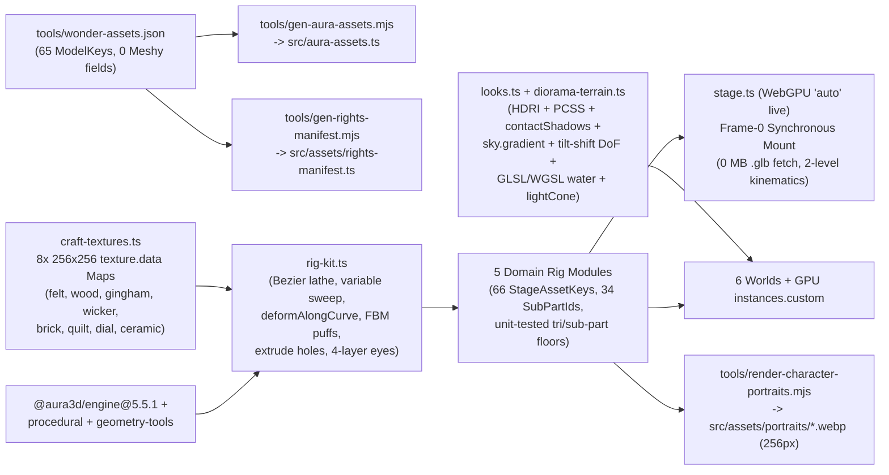
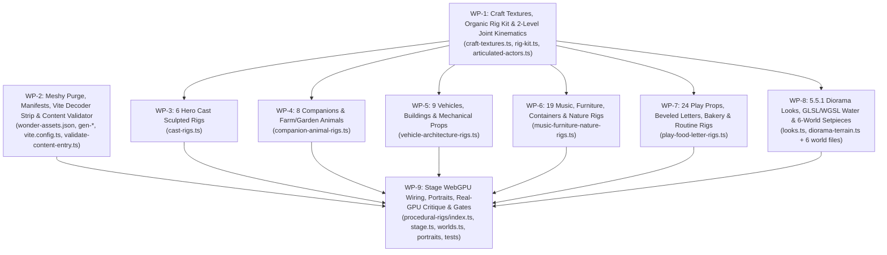

# PRD: Veer Wonder World (`@aura3d/wonder-world`) — 100% Native `@aura3d/engine@5.5.1` Procedural 3D & Graphics Revamp (Zero Meshy / Zero `.glb`)

- **Document Path:** `docs/prds/veer-wonder-world/aura3d-5.5.1-procedural-no-meshy-revamp-prd.md`
- **Target Package:** `@aura3d/wonder-world` (`apps/veer-wonder-world/`)
- **Canonical Live Host:** Cloudflare Pages `aura3d-wonder-world` (`https://veer.auraone.ai` -> `aura3d-wonder-world.pages.dev`)
- **Engine Target:** `@aura3d/engine@5.5.1` (`@aura3d/engine`, `@aura3d/engine/procedural`, `@aura3d/engine/geometry-tools`, `@aura3d/engine/game`, `@aura3d/engine/math`)
- **Execution Policy:** Authorized for immediate autonomous product code implementation (`CODE_COMPLETE_GO`).

> **Mandatory Execution & Anti-Loop Contract:**
> 1. **Read-Only Blueprint During Code Execution:** Executing agents and subagents must treat this PRD as a **read-only engineering blueprint** during implementation. Do **NOT** repeatedly edit or commit this `.md` file to tick checkboxes, rewrite status tables, or append run logs after each work package.
> 2. **Frozen Denominator:** Executing agents must never add new checkboxes, work packages, or external-review items to this PRD, and must never invoke external LLM/ChatGPT/Prism critic loops mid-execution.

---

## 1. Executive Summary & Architectural Decisions

### 1.1 Objective
Completely eliminate all **54 Meshy text-to-3D `.glb` blobs (`25.5 MB`)**, their Meshy provenance records, Meshy UV/triangle-slicing workarounds, and Draco/Meshopt/Basis decoder bundle overhead from Veer Wonder World (`apps/veer-wonder-world/`), replacing all **66 `StageAssetKey`s (`65 ModelKey`s + `"bubble"`)** and upgrading all **6 worlds** to a **Nintendo *Link's Awakening* (Switch) / *Yoshi's Crafted World* / Apple Arcade tactile miniature toy-diorama standard** built 100% natively on `@aura3d/engine@5.5.1` (`@aura3d/engine`, `@aura3d/engine/procedural`, `@aura3d/engine/geometry-tools`).

To guarantee zero visual disappointment, this revamp simultaneously eradicates **both** failure modes — muddy single-mesh Meshy clay blobs **and** lazy "snowman / balloon-animal / flat-plastic" primitive stacks — by combining:
1. **Anatomical Spline, Sweep & FBM-Displaced Organic Sculpting** (`45–90` sub-shapes & `1,800–4,200` triangles per cast character; `28–70` sub-shapes & `900–3,400` triangles per animal/vehicle/building; `8–35` sub-shapes & `240–1,800` triangles per prop, enforced automatically by unit tests),
2. **Zero-File `256×256` Procedural Craft Albedo & Micro-Normal Textures** (`craft-textures.ts`: felt bouclé, maple wood grain, woven gingham, rattan wicker, limestone/brick mortar, diamond quilt stitch, storybook clock dials, and stoneware ceramic speckle via `texture.data` + `material.proceduralTextures.*`),
3. **Full `@aura3d/engine@5.5.1` Diorama Graphics Activation** (**WebGPU-first `backend: "auto"`** for live players with seamless WebGL2 fallback, live `effects.contactShadows` grounding, `sky.gradient` sunlit cloud domes, subtle miniature tilt-shift `effects.depthOfField`, `effects.lightCone` cozy sunbeams, and paired GLSL+WGSL animated water ripple shaders), and
4. **4-Layer 3D Eyes, Blinking Plush Eyelids, 34-Joint Hierarchical Kinematics, Re-Rendered Studio Portraits, `0 MB` `.glb` Network Fetches, & Mandatory Real-GPU `1280×960` Close-Up Visual Critique Before `CODE_COMPLETE_GO`**.

### 1.2 Autonomous Architectural & Product Decisions

1. **100% Meshy Removal & First-Party IP Ownership:**
   - Delete all 54 binary `.glb` files in `apps/veer-wonder-world/src/assets/models/*.glb`, all 54 provenance JSONs in `apps/veer-wonder-world/provenance/models/*.json`, `tools/model-review.json`, and all 7 Meshy pipeline/surgery scripts (`meshy-pipeline.mjs`, `admit-models.mjs`, `recolor-atlas-regions.mjs`, `jpeg-normal-maps.mjs`, `build-articulated-cast.mjs`, `cut-cake-flame.mjs`, `bake-armature-scale.mjs`).
   - Update `tools/gen-rights-manifest.mjs` so `MODEL_RIGHTS = []` and all 65 `ModelKey`s live in `PROCEDURAL_RIGHTS` under 100% first-party AuraOne ownership (`"Original procedural @aura3d/engine stage art owned by AuraOne"`), completely retiring third-party Meshy `"exclusivity not claimed"` licensing terms.
2. **Anti-"Snowman / Balloon-Animal" Organic Sculpting Law & Automated Triangle/Sub-Part Quality Floors:**
   - **Hard Prohibition on Raw Primitive Stacking:** Stacking raw `primitives.sphere`, `primitives.capsule`, or `primitives.cone` shapes for character/animal torsos, heads, limbs, ears, snouts, wool coats, or tree canopies is strictly forbidden (it produces cheap "snowman / balloon-animal" seams).
   - **Mandatory Spline & Surface-Modifier Sculpting (`@aura3d/engine/procedural` + `@aura3d/engine/geometry-tools`):**
     - *Torsos, heads, snouts & vessels:* Multi-inflection cubic Bezier `path2d().cubicTo(...)` profiles (`>= 24` profile samples × `32–40` radial segments) via `latheGeometry` and azimuthal cheek/belly/snout modulation via `parametricSurface`.
     - *Arms, legs, tails, ears, horns, stems & tree trunks:* Variable-radius `sweepGeometry` along `cubicBezierCurve` / `catmullRomCurve` spines and `deformAuraMeshAlongCurve(...).geometry` with smooth shoulder/elbow/paw tapers.
     - *Wool, foliage & cloud clusters:* `tessellateAuraMesh(...).geometry` displaced by deterministic 3D `createFbm3D` surface ripples + `weldAuraGeometry` + `computeAuraCreasedNormals` so fleece, bushes, and canopies read as hand-felted craft rather than geometric balls.
     - *Architecture, frames, wings & typography:* Multi-contour `primitives.extrude` (`extrudeContourSpec`) with true open `holes` (hollow `tunnel` bore, open `A/a/B/b` typographic counters, mullioned arches) and crisp toddler-safe chamfered bevels (`roundedBoxSpec`).
   - **Automated Quantitative Quality Floors (`tests/unit/stage/spots.test.ts`):** Every `StageAssetKey` is tested in CI against hard minimum sub-shape, triangle, and craft-lobe floors so placeholder art fails `CODE_COMPLETE_GO` automatically:
     - **6 Hero Cast (`momo, lulu, sheru, gogo, lumi, peeko`):** `1,800 <= triangles <= 4,200`, `>= 45` composed sub-shapes, `>= 3` distinct `CraftFamily` lobes, 4-layer 3D eyes + blinking `eyelidL/R` + articulated `jaw`/`beakLower`/`cheekPuff`.
     - **17 Companions, Animals, Vehicles & Buildings (`teddy, robot, cow, sheep, duck, horse, bird, butterfly, gogoCarriage, car, barn, station, tunnel, house, door, lift, colourMachine`):** `900 <= triangles <= 3,400` (`>= 600` for small `bird`/`butterfly`), `>= 28` composed sub-shapes (`>= 18` for `bird`/`butterfly`), `>= 2` `CraftFamily` lobes.
     - **41 Instruments, Furniture, Containers, Letters & Everyday Props:** `240 <= triangles <= 1,800`, `>= 8` composed sub-shapes (`>= 160` tris on `"bubble"`, `>= 120` tris on `"candleFlame"`).
3. **Zero-File `256×256` Procedural Craft Albedo & Micro-Normal Texture Library (`src/scenes/procedural-rigs/craft-textures.ts`):**
   - Flat untextured vertex colors alone can still read as smooth Three.js plastic under studio light. `craft-textures.ts` generates **8 memoized deterministic `256×256` sRGB `texture.data({ width: 256, height: 256, data, format: "rgba", colorSpace: "srgb" })` craft maps** (`0 MB` network fetch, synchronous in Node/WebGL2/WebGPU) paired with `material.proceduralTextures.{fabric, rubber, brushedMetal, plastic}`:
     1. `feltBoucleTexture` (warm melange wool fiber weave & bouclé pores for cast, plushies & felt props),
     2. `woodGrainPlankTexture` (fine maple/cedar cathedral grain & plank lines for barn, furniture, piano, drum hoops & blocks),
     3. `ginghamCheckTexture` (crisp woven red-and-cream gingham cloth for `picnicBasket` liner & meadow picnic accents),
     4. `wickerWeaveTexture` (interlaced honey-rattan basket weave for `picnicBasket`),
     5. `storybookBrickMasonryTexture` (warm limestone/terracotta courses + soft mortar for `station`, `tunnel`, `barn` plinth & `house`),
     6. `quiltedStitchTexture` (diamond quilt stitching & plush terry loops for `bed` blanket, `cushion` & `towel`),
     7. `clockAndGaugeDialTexture` (crisp 12-dot storybook clock & pressure dial face for `station` gable clock, `home-nook` wall clock, `colourMachine` & `lift`),
     8. `glazedCeramicSpeckleTexture` (subtle stoneware kiln speckle + warm micro-grain applied to `ceramic`/`clay` rigs **and** `diorama-terrain.ts` `primitives.*` world materials, simultaneously eliminating plastic sheen and keeping `lookLint` `look/primitive-subject` at `0` warnings).
4. **Draw-Call Consolidation via Per-Joint Material-Lobe Merging (`composeGeometry`):**
   - Instead of spawning 50–80 scene-graph nodes per character, static sub-shapes sharing the same tactile `CraftFamily` + craft texture within a single rigid `SubPartId` are merged into **1 `AuraCustomGeometrySpec`** via `composeGeometry` using linear-RGB vertex colors (`srgbHexToLinearRgba`) multiplied against the neutral-centered `256×256` craft albedo (`color: "#FFFFFF"`).
   - Result: a 70-part sculpted hero character with woven felt grain, satin muzzle clay, glossy 4-layer eyes, and brass hardware mounts in **6–11 total draw calls** (well inside Wonder World's `180` draw-call budget across all 32 stories and activities).
5. **Top-Level Joint Nodes (`${actorId}__${partId}`) & Zero `PIVOT_UNSUPPORTED_LEGACY_HIERARCHY` Errors:**
   - `@aura3d/engine`'s `pivotGuard.ts` throws `PIVOT_UNSUPPORTED_LEGACY_HIERARCHY` if non-zero `pivot` is placed on or inside `groups.create`.
   - Every articulated `SubPartId`'s merged `AuraCustomGeometrySpec` is baked so mesh-local `[0, 0, 0]` sits at its exact **anatomical joint hinge** (shoulder, hip, neck base, jaw hinge, eyelid arc center, wheel axle, left door jamb, rear lid rim), with its rest offset stored in `anchor: Vec3` (fractions of `h`). Each rigid part mounts as a top-level runtime mesh node (`id: "${actorId}__${partId}"`, `pivot: undefined`), driven by a deterministic 2-level kinematic parent map (`SUB_PART_PARENT`: `body -> head -> {eyelidL, eyelidR, jaw, beakLower, cheekPuff, earL, earR, tuft}` and `body -> {armL, armR, wingL, wingR, tail, chimney, cabDoorL, cabDoorR}`) in `src/scenes/articulated-actors.ts` and `src/scenes/stage.ts`.
6. **Unified Synchronous Stage Architecture (`drawnAs: "procedural"`, Zero `.glb` Preloader):**
   - Delete `src/runtime/asset-preloader.ts` (which existed solely to `fetch()` `.glb` binaries with 3.5s–180s timeouts) and `tests/unit/stage/asset-preloader.test.ts`.
   - Every stage actor and prop mounts synchronously on Frame 0 from memoized unit-height (`h = 1.0`) `AuraCustomGeometrySpec` recipes (`Map<StageAssetKey, ProceduralAssetRig>`), tagged with `["wonder-node", id, "procedural"]` and reporting `drawnAs: "procedural"` in `StageNodeSnapshot` and `proceduralNodes: number` in `StageDiagnostics`.
   - Author all 66 procedural rigs facing **`+Z` natively** (`yaw = 0` looks toward the camera), eliminating `MODEL_FRONT_YAW` (`Math.PI / 2` Meshy sideways workaround on `gogo`, `gogoCarriage`, `car`).
7. **Removal of `/aura-decoders/` Bundle Bloat While Keeping CLI Gates Green:**
   - Remove Draco, Meshopt, and Basis `/aura-decoders/` middleware and `closeBundle` copying from `apps/veer-wonder-world/vite.config.ts` (`TypedGLBActor` and `KTX2Loader` are never invoked when `modelNodes.length === 0` and zero `.ktx2` files exist).
   - **Keep `apps/veer-wonder-world/aura.assets.json` (`"assets": []`) and `apps/veer-wonder-world/src/aura-assets.ts` on disk** because `@aura3d/cli@5.5.1 check-deploy` checks `existsSync` on both files.
8. **Studio-Lit 3D Portrait Regeneration (`tools/render-character-portraits.mjs`):**
   - Replace `tools/make-portraits.sh` with `tools/render-character-portraits.mjs`, capturing 2× supersampled (`512×512` -> `256×256` WebP) front-3/4 studio portraits directly from the new procedural character rigs (`momo`, `lulu`, `sheru`, `gogo`, `lumi`, `peeko`), updating `provenance/portraits.json` and regenerating `src/assets/rights-manifest.ts`.
9. **WebGPU-First Live Rendering (`backend: "auto"`) + Full `@aura3d/engine@5.5.1` Diorama Graphics Activation:**
   - **Unlock WebGPU for Live Players (`stage.ts`):** Today `stage.ts:1129–1134` hardcodes `webgl2` unless `?backend=webgpu` is in the URL. Change `resolvedBackend` to `options.backend ?? (options.manualClock === true || softwareRenderer ? "webgl2" : "auto")` so live players on Apple Silicon, modern desktop, and iPadOS get native **WebGPU** with automatic WebGL2 fallback, while deterministic `manualClock` QA retains synchronous `app.step(0)` WebGL2 pixel readback (`?backend=webgpu` and `?backend=webgl2` explicit overrides continue to work identically).
   - **Mount Dead `WORLD_LOOKS` 5.5.1 Nodes in `src/scenes/looks.ts` (`worldLookNodes`):** `WORLD_LOOKS` already authored `contactShadows` and `sky` specs per world, yet `worldLookNodes()` never emitted them! Wire `worldLookNodes` on GPU (`!softwareRenderer`) to emit:
     - `effects.contactShadows({ name: "${world} contact grounding", length: spec.contactShadows.length, thickness: 0.05, steps: 14, intensity: spec.contactShadows.intensity, lights: "sun" })` (grounds every foot, paw, wheel, block, and table leg like a Blender Cycles clay render),
     - `sky.gradient({ name: "${world} sky dome", ...spec.sky, captureEnvironment: false, affectsFog: false, clouds: { coverage: 0.28, speed: options.reducedMotion ? 0 : 0.12, color: "#FFFDF8" } })` on all 5 outdoor/sky worlds (`spec.sky !== null`; `captureEnvironment: false` keeps `snapshot.environment.kind === "hdri"` intact),
     - `effects.depthOfField({ name: "${world} miniature tilt-shift", focus: 0.22, aperture: 0.018, maxBlur: 0.004 })` for subtle *Link's Awakening* macro lens softness on distant `-11m` hills while keeping the entire active stage (`z ∈ [-3.2, +2.0]`) razor-sharp.
   - **Paired GLSL+WGSL Animated Water Shaders & Cozy Volumetric Light Cones:** Upgrade `buildCalmPondNode` (`diorama-terrain.ts`) for the meadow brook, music-garden lotus pond, and barn duck pond with paired `glsl` + `wgsl` `material.custom` animated ripples, shoreline foam rings, and sky shimmer (`override a3dZeroToOneProjection: bool = false;`, paused when `reducedMotion: true`, zero `water.surface` deprecation warnings), plus `effects.lightCone` warm afternoon window sunbeams in `home-nook.ts` (hidden during bedtime in `shiftHomeNookTimeOfDay`).
   - **Zero Engine / Art-Audit / `lookLint` Warnings:** Every emissive material with `emissiveIntensity > 0.1` sets `practical: true` (`game-checks.mjs` `emissive-fill`), transparent glass/bubbles use thin-film `alphaMode: "blend"` + `iridescence` (`0` `TRANSMISSION_DEGRADED`), and zero mesh names use fake-effect words (`look/fake-effect-names`).
10. **Mandatory Real-GPU `1280×960` Close-Up & Turnaround Visual Critique Gate Before `CODE_COMPLETE_GO`:**
    - Automated triangle counts alone never prove artistic charm. Before declaring `CODE_COMPLETE_GO` (`WP-9` / Phase A), render `1280×960` close-up 4-angle turnarounds of all 6 cast rigs, hero animals/vehicles/buildings, and all 6 live worlds on real Apple Silicon GPU via loopback headless Chrome CDP (both WebGPU and WebGL2), inspect every render directly with `read_file`, and immediately resculpt any rig showing snowman sphere seams, flat plastic surfaces, cross-eyed gaze, or floating contact.

---

## 2. Current Codebase State & System Architecture

### 2.1 Current Meshy-Bound Pipeline & Why Visuals Fell Short
Today, `@aura3d/wonder-world` (`apps/veer-wonder-world/`) ships **32 playable interactive items** (`20` voiced episodes `E01`–`E20` in `src/content/episodes/` and `12` tap activities `G01`–`G12` in `src/content/activities/`) set across **6 miniature toy-island worlds** (`meadow`, `music-garden`, `peekaboo-barn`, `station`, `learning-cloud`, `home-nook`).

Despite upgrading to `@aura3d/engine@5.5.1` terrain plinths, visuals fell short for **two** compounding reasons:
- **54 Muddy Meshy `.glb` Blobs (`25.5 MB`):** `apps/veer-wonder-world/src/assets/models/*.glb` holds 54 hashed `.glb` binaries (`momo` 1.40 MB, `lulu` 1.67 MB, `sheru` 1.63 MB, `gogo` 1.62 MB, `peeko` 1.79 MB, `barn` 1.06 MB, etc.) where eyes, mouths, fur, buttons, roof tiles, windows, and fake shadows are baked into a single muddy 512px–1024px JPEG over blobby triangles. Slicing those shells in `tools/build-articulated-cast.mjs` still left painted-on blurry eyes, melted silhouettes, sideways `-X` vehicle orientations (`MODEL_FRONT_YAW`), and minute-long `.glb` preloader stalls (`src/runtime/asset-preloader.ts`, `/aura-decoders/`).
- **Dormant `@aura3d/engine@5.5.1` Diorama Capabilities in `looks.ts` & `stage.ts`:** `WORLD_LOOKS` in `src/scenes/looks.ts` defined `contactShadows` and `sky` specs that `worldLookNodes()` never mounted, `stage.ts` forced `webgl2` even on WebGPU-capable browsers, and ponds used static unrippled discs — leaving sky backdrops flat and props lacking close-range contact grounding.

### 2.2 Target Zero-Meshy `@aura3d/engine@5.5.1` Procedural & Diorama Graphics Architecture



### 2.3 Repo-Specific Constraints & Invariants
1. **Dual TypeScript Gate (`check-all.sh`):** Code must pass **both** workspace `pnpm typecheck` (`packages/engine/src/public/*.ts`) and published `tsconfig.published.json` (`node_modules/@aura3d/engine@5.5.1`). Import only verified public symbols (Section 3.1).
2. **Strict Source Guards (`tests/unit/privacy/source-guards.test.ts` & `no-child-data.test.ts`):**
   - Zero `any`, zero `eval`, zero `console.*`, and **zero `as T` TypeScript casts** (`as const` is permitted) anywhere in `apps/veer-wonder-world/src/**/*.ts`.
   - Zero occurrences of the child's name `"veer"` (case-insensitive) in `src/`, `public/`, or `index.html` outside the single welcome config (`src/personal.ts`).
   - Zero `Math.random()`, `Date.now()`, or `performance.now()` in deterministic stage/motion/procedural-rig modules (`tests/unit/stage/motion.test.ts`); use `seededRandom` from `@aura3d/engine/procedural` or `createDeterministicRng` from `src/scenes/diorama-terrain.ts`.
3. **Remote-First Execution & Loopback CDP Exception:** Never run local Docker or local Playwright. All Playwright suites run via `apps/veer-wonder-world/tools/remote-run.sh` on serverless Azure ACR Tasks (`az-auraone-gurbaksh`) with immediate `0`-remnant cleanup; local headless Chrome over loopback CDP (`127.0.0.1:9222`) is permitted solely for local dev-server inspection and `tools/render-character-portraits.mjs` studio capture, and must be terminated immediately after capture.

---

## 3. Data Model, API & Interface Contracts

### 3.1 Verified `@aura3d/engine@5.5.1` Public Import Contracts

```ts
// 1. Root @aura3d/engine (verified identical in workspace public/index.ts & published 5.5.1):
import {
  createAuraApp, scene, group, groups, primitives, geometry, material,
  instances, mergeStatic, mergeStaticByKey, scatterInArea, scatterAlongPath,
  scatterTransforms, createScatterRandom, looks, lights, effects, environments,
  water, sky, weather, texture,
  type AuraApp, type AuraColor, type AuraVec2, type AuraVec3,
  type AuraTransformSpec, type AuraMaterialSpec, type AuraMaterialRimSpec,
  type AuraCustomGeometrySpec, type AuraCustomGeometryOptions,
  type AuraStaticMeshPart, type AuraInstanceWindOption,
  type AuraNodeBuilder, type AuraNodeInput, type AuraSceneNode,
  type AuraRuntimeNodeHandle
} from "@aura3d/engine";

// 2. @aura3d/engine/procedural (primary 3D sculpting builders):
import {
  seededRandom, createSimplexNoise2D, createSimplexNoise3D, createFbm2D, createFbm3D,
  path2d, polylineCurve, catmullRomCurve, cubicBezierCurve, sampleCurve,
  latheGeometry, sweepGeometry, parametricSurface, heightfieldGeometry, composeGeometry,
  type ProceduralGeometry, type ProceduralVec2, type ProceduralVec3,
  type ProceduralColor, type ComposePart
} from "@aura3d/engine/procedural";

// 3. @aura3d/engine/geometry-tools (optional mesh modifiers):
import {
  tessellateAuraMesh, deformAuraMeshAlongCurve, splitAuraMeshEdges,
  computeAuraCreasedNormals, weldAuraGeometry
} from "@aura3d/engine/geometry-tools";
```

> **Engine Pitfall Guardrails (Hard Rules for All Subagents):**
> - **Never import internal-only types** (`AuraPrimitiveOptions`, `AuraPrimitiveParams`, `AuraBuiltinPrimitive`, `AuraGroupNode`, `AuraInstanceNode`) — they are absent from published `@aura3d/engine@5.5.1`.
> - **Never call non-existent material builders** (`material.clay`, `material.velvet`, `material.wood`). Use `material.matteClay(...)`, `material.felt(...)`, `material.fabric(...)`, `material.ceramic(...)`, `material.lacquer(...)`, `material.clearcoatPaint(...)`, `material.carPaint(...)`, `material.brushedMetal(...)`, `material.blackRubber(...)`, `material.rubber(...)`, `material.standard(...)`, `material.physical(...)`, and `material.proceduralTextures.{fabric,rubber,brushedMetal,plastic}(...)`.
> - **`MeshModifiers` Return-Type Unwrap Rule:** `tessellateAuraMesh`, `deformAuraMeshAlongCurve`, `splitAuraMeshEdges`, and `simplifyAuraMesh` from `@aura3d/engine/geometry-tools` return `AuraMeshModifierResult` (`{ geometry: AuraCustomGeometrySpec, diagnostics, stats }`), **NOT** a bare `AuraCustomGeometrySpec`. Always unwrap `.geometry` before passing to `composeGeometry`, `weldAuraGeometry`, or `computeAuraCreasedNormals`.
> - **`composeGeometry` Linear Color & `XYZ` Euler Rule:** `composeGeometry` interprets `part.color` `[r, g, b, a]` in **linear RGB `[0..1]`** (NOT sRGB!) and applies `part.rotation` in **`XYZ`** Euler order. Always convert hex strings via `srgbHexToLinearRgba(hex)` in `rig-kit.ts` so pastel colors never wash out under AgX tone mapping.
> - **`primitives.extrude` Bevel Default:** `bevelEnabled` defaults to `true` with `bevelThickness: 0.2, bevelSize: 0.1`! Always pass explicit small bevels (e.g. `bevelThickness: 0.014, bevelSize: 0.01, bevelSegments: 2`) or `bevelEnabled: false`.
> - **Practical Emissive Rule (`game-checks.mjs`):** Any material with `emissiveIntensity > 0.1` **MUST** include `practical: true`.
> - **Zero `TRANSMISSION_DEGRADED` & Zero `water.surface` Warnings:** Never set `transmission > 0` or call `material.glass()` / `material.studioGlass()` on stage meshes; use `glassCoatMat` (`material.physical({ color, opacity: 0.32, alphaMode: "blend", roughness: 0.06, clearcoat: 0.92, iridescence: 0.85, iridescenceIOR: 1.33, iridescenceThicknessRange: [180, 480] })` + `castShadow: false`). Never call `water.surface(...)` (which logs a deprecation warning under `A3D_QR_WORLD_WATER`); use paired `glsl` + `wgsl` `material.custom` water shaders (`override a3dZeroToOneProjection: bool = false;`).
> - **`lookLint` Zero-Warning Guardrails (`look/primitive-subject` & `look/fake-effect-names`):** Because `geometry.custom(...)` compiles to `kind: "custom-geometry"`, any remaining `primitives.*` nodes in world scenes (`diorama-terrain.ts`) are the sole `kind: "primitive"` items inspected by `look/primitive-subject`! Attach a `texture` map from `craft-textures.ts` (e.g. `glazedCeramicSpeckleTexture` or `woodGrainPlankTexture`) to world `primitives.*` materials so untextured primitives stay `< 60%` (`0%` target), never match `/subject|hero|player|product|character|car\b|vehicle|fighter|ship|avatar/i` in any `primitives.*` `name`, and never use fake-effect words (`shadow`, `glow`, `bloom`, `reflection`, `fog`, `godray`, `sunbeam`) in mesh/group `name`s (use real `effects.lightCone`, `effects.contactShadows`, etc.).

### 3.2 `src/aura-assets.ts` Contract (Generated by `tools/gen-aura-assets.mjs`)

```ts
// GENERATED by tools/gen-aura-assets.mjs from tools/wonder-assets.json. Do not edit by hand.
export const MODEL_KEYS = [
  "momo","lulu","sheru","gogo","gogoCarriage","lumi","peeko",
  "teddy","robot","cow","sheep","duck","horse","bird","butterfly",
  "ball","bubbleWand","cookie","plate","mirror","door","letterB","letterA",
  "apple","banana","cake","drum","shaker","toyPiano","picnicBasket","car",
  "sponge","towel","toyBlock","lift","flower","flowerBud","tree","bush",
  "barn","station","tunnel","house","bed","sink","table","chair","cushion",
  "toyBox","bench","colourMachine","storyBox","pastryCircle","pastrySquare",
  "pastryTriangle","hat","stompStone","cloud","balloon","letterBLower",
  "letterALower","toothbrush","sun","candleFlame","partyHat"
] as const;

export type ModelKey = (typeof MODEL_KEYS)[number];
export type AssetRole = "character" | "vehicle" | "prop" | "background";

export interface ModelInfo {
  readonly heightM: number;
  readonly role: AssetRole;
  readonly face: boolean;
  readonly procedural: true;
}

export const MODEL_INFO: Readonly<Record<ModelKey, ModelInfo>> = { /* all 65 entries */ };
export const PROCEDURAL_MODELS: readonly ModelKey[] = MODEL_KEYS;
```

### 3.3 Procedural Rig Kit & 2-Level Kinematic Joint Contract (`src/scenes/procedural-rigs/rig-kit.ts`)

```ts
import type { AuraColor, AuraCustomGeometrySpec, AuraMaterialSpec, AuraNodeBuilder, AuraSceneNode } from "@aura3d/engine";
import type { SubPartId } from "../articulated-actors.js";
import type { StageAssetKey } from "../stand-ins.js";
import type { Vec3 } from "../motion.js";

export type CraftTextureId =
  | "feltBoucle"
  | "woodGrainPlank"
  | "ginghamCheck"
  | "wickerWeave"
  | "storybookBrickMasonry"
  | "quiltedStitch"
  | "clockAndGaugeDial"
  | "glazedCeramicSpeckle";

export type CraftFamily =
  | "felt"
  | "clay"
  | "ceramic"
  | "lacquer"
  | "wood"
  | "carPaint"
  | "brushedMetal"
  | "rubber"
  | "glassCoat"
  | "soapBubble"
  | "warmGlow";

/** One merged draw-call mesh lobe inside a rigid SubPartId (or static prop root). */
export interface ProceduralLobeSpec {
  readonly suffix: string;
  readonly craft: CraftFamily;
  /** Optional explicit 256×256 craft texture override (defaults by CraftFamily, e.g. felt -> feltBoucle, wood -> woodGrainPlank). */
  readonly craftTexture?: CraftTextureId;
  /** Unit-height (h = 1.0) custom geometry with [0, 0, 0] already shifted to the SubPartId's hinge! */
  readonly geometry: AuraCustomGeometrySpec;
  /** Base material tint ("#FFFFFF" when vertex colors encode multi-tone palette). */
  readonly baseColor: AuraColor;
  /** Receives runtime PropPlacement.tint / "tint" / applyCarWashState updates. */
  readonly tintTarget?: boolean;
  readonly castShadow?: boolean;
  readonly receiveShadow?: boolean;
  readonly emissive?: AuraColor;
  readonly emissiveIntensity?: number;
}

export interface ProceduralSubPartRig {
  readonly part: SubPartId;
  /** Joint hinge position in unit-height (h = 1.0) actor space relative to ground-center [0, 0, 0]. */
  readonly anchor: Vec3;
  /** Optional parent joint for 2-level kinematic composition (e.g. jaw -> head -> body). */
  readonly parent?: SubPartId;
  /** 1–2 merged material lobes (typically 1 felt/wood lobe + 1 optional gloss/eye/metal lobe). */
  readonly lobes: readonly ProceduralLobeSpec[];
}

export interface ProceduralAssetRig {
  readonly key: StageAssetKey;
  /** Total authored sub-shapes merged across all parts (tracked automatically by composeLobe for CI quality-floor assertions). */
  readonly subShapeCount: number;
  /** Total triangle count across interactive parts (computed from indices.length / 3 for CI quality-floor assertions). */
  readonly triangleCount: number;
  /** Rigid articulated parts (for actors/interactive props) and/or `"body"` root lobes (for static props). */
  readonly parts: readonly ProceduralSubPartRig[];
  /** Static merged unit-height lobes when mounted as non-interactive world dressing (1–2 draw calls total). */
  readonly staticDressingLobes: readonly ProceduralLobeSpec[];
}

export interface BuildProceduralActorOptions {
  readonly id: string;
  readonly key: StageAssetKey;
  readonly heightM: number;
  readonly tint?: AuraColor;
  /** False for static world dressing: emits merged staticDressingLobes with no runtime IDs. */
  readonly interactive: boolean;
}

export interface MountedRigPiece {
  readonly runtimeId: string;
  readonly part: SubPartId;
  readonly parent?: SubPartId;
  /** Scaled anchor [anchorX * h, anchorY * h, anchorZ * h] relative to actor ground origin. */
  readonly anchorM: Vec3;
  readonly tintTarget: boolean;
  readonly baseColor: string;
  readonly craft: CraftFamily;
}

export interface BuiltProceduralActor {
  readonly nodes: readonly AuraNodeBuilder<AuraSceneNode>[];
  readonly pieces: readonly MountedRigPiece[];
  readonly subParts: ReadonlySet<SubPartId>;
  readonly tintableIds: readonly string[];
}
```

#### Canonical 2-Level `SUB_PART_PARENT` Kinematic Chain (`src/scenes/articulated-actors.ts`)
When `stage.ts` places `${actorId}__${part}` (and subsidiary lobe `${actorId}__${part}~${lobe}`), it composes transforms in parent order (`actorRoot -> body -> head -> leafPart`) so eyes, eyelids, jaws, beaks, cheeks, ears, and tufts stay locked onto the head during `computeHeadGaze`, `nod`, `tilt`, `sniff`, and `bow`:
- `body` -> *(actor root)*
- `head`, `armL`, `armR`, `wingL`, `wingR`, `tail`, `chimney`, `cabDoorL`, `cabDoorR` -> `body`
- `eyelidL`, `eyelidR`, `jaw`, `beakLower`, `cheekPuff`, `earL`, `earR`, `tuft` -> `head`
- `footL`, `footR`, `legFL`, `legFR`, `legBL`, `legBR`, `wheelFL`, `wheelFR`, `wheelRL`, `wheelRR`, `petals`, `hingeLeaf`, `hingeLeafR`, `lid`, `liftCab`, `liftGate` -> *(actor root)*

### 3.4 Complete 66-Asset Procedural Sculpting Contract (`65 ModelKey`s + `"bubble"`)

Every rig MUST match `MODEL_INFO[key].heightM` (`0.5m` for `"bubble"`), `ASSET_TRAITS[key]` (`width`, `depth`, `layout`, `restAt`), ground contact `y = 0`, top `y = h`, native **`+Z` forward facing**, and the triangle/draw-call budgets below:

#### Group 1 — Hero Cast (`src/scenes/procedural-rigs/cast-rigs.ts` — 6 keys, `1,800 <= tris <= 4,200`, `>= 45` sub-shapes & `<= 11` draw calls each)
| Key | `h` (m) | Required `SubPartId`s | Procedural Sculpting Blueprint (`@aura3d/engine/procedural` + `rig-kit.ts`) |
|---|---|---|---|
| `momo` | `0.90` | `body, head, armL, armR, footL, footR, eyelidL, eyelidR, jaw, cheekPuff` | Pear-shaped `latheGeometry` plum felt torso (`#8E6CD8`) + stitched cream belly medallion (`#F6EFE6`) + dorsal felt spine tufts (`back` asymmetry); wide plush `head` with 2 curved cream `sweepGeometry` nubbins, 4-layer porcelain/espresso/catchlight eyes, hemispherical plum `eyelidL/R`, sculpted lower smile lip + coral inner mouth (`jaw`), rosy `cheekPuff` ovals, plump curved `sweepGeometry` `armL/R` with 3 little thumb/finger puffs, chunky `footL/R` with 3 cream toe beans. |
| `lulu` | `1.00` | `body, head, armL, armR, footL, footR, tail, eyelidL, eyelidR, jaw, cheekPuff` | Tapered mint dino `latheGeometry` torso (`#7ED6AE`) + scalloped buttercream tummy ribs (`#FFF4DE`) + coral back plates (`#F28C7E`); rounded dino snout `head` with crown plates, 4-layer forest-iris eyes, mint `eyelidL/R`, articulated lower dino `jaw`, coral `cheekPuff`, clapping `armL/R`, stomping 3-clawed soft `footL/R`, S-curved `sweepGeometry` dino `tail` (`-Z`). |
| `sheru` | `0.70` | `body, head, earL, earR, tail, legFL, legFR, legBL, legBR, eyelidL, eyelidR, jaw` | Horizontal biscuit puppy barrel chest (`#EAD3A8`) + cocoa saddle patch (`#8B5E3C`) + stitched coral collar (`#E25B4B`) + brushed-brass round tag (`#F2C94C`); rounded puppy `head` (`[0, 0.52h, +0.26h]`) with cream muzzle, glossy chocolate `lacquer` nose, 4-layer warm-brown eyes, biscuit `eyelidL/R`, lower `jaw` with soft pink tongue, floppy teardrop `sweepGeometry` cocoa `earL/R`, curled wagging `sweepGeometry` cocoa-tipped `tail`, 4 pawed `legFL..BR` with toe pads. |
| `gogo` | `0.90` | `body, chimney, wheelFL, wheelFR, wheelRL, wheelRR, cabDoorL, cabDoorR, eyelidL, eyelidR, jaw` | **Faces `+Z` natively!** `carPaint` bright red cylindrical boiler (`#E2483D`) with brass boiler bands (`#F2C94C`), steam dome, `brushedMetal` brass bell, warm-glow headlamp (`practical: true`), cowcatcher pilot grilles on `+Z`, arched engineer cab (`-Z`) with `glassCoat` windows & coal bunker, cream relief smokebox face disc on `+Z` with 4-layer eyes, red `eyelidL/R`, smiling bumper `jaw`, flared brass-lip `chimney`, hinged `cabDoorL/R`, 4 spoked `latheGeometry`+extruded-spoke flanged wheels (`wheelFL..RR`) with red hubs + brass coupling rods so rotation is unmistakable. |
| `lumi` | `0.65` | `body, petals, eyelidL, eyelidR, cheekPuff` | Plump pillowed central star cushion (`body`, warm gold `#FFD34D` + `emissive: "#FFD34D", emissiveIntensity: 0.22, practical: true`) with 4-layer amber eyes, golden `eyelidL/R`, and warm `cheekPuff`; outer 5-pointed chamfered `extrudeContourSpec` star halo (`petals`, butter-gold bevels + tiny orbital pearl tips + back filigree medallion for turnaround asymmetry) rotating smoothly around `Z`. |
| `peeko` | `0.55` | `body, head, wingL, wingR, tuft, footL, footR, eyelidL, eyelidR, beakLower` | Plump egg `latheGeometry` sunny-yellow chick body (`#FFE15A`) + scalloped cream breast bib (`#FFF6C7`) + upturned tail-feather fan (`-Z`); round chick `head` with sculpted tangerine upper beak (`#FF8C42`), 4-layer eyes, yellow `eyelidL/R`, hinged `beakLower`, 3-plume `sweepGeometry` crown `tuft`, layered feather-paddle `wingL/R`, 3-toed webbed orange `footL/R`. |

#### Group 2 — Friends & Animals (`src/scenes/procedural-rigs/companion-animal-rigs.ts` — 8 keys, `900 <= tris <= 3,400` [`>= 600` on `bird`/`butterfly`], `>= 28` sub-shapes [`>= 18` on `bird`/`butterfly`] & `<= 9` draw calls each)
- **`teddy` (`0.55m`):** Stitched honey-brown felt bear (`body, head, earL, earR, armL, armR, footL, footR, eyelidL, eyelidR`), cream snout & paw pads, glossy button eyes with highlight dots, ribbon bow tie, plump rump seam.
- **`robot` (`0.80m`):** Chamfered `roundedBoxSpec` sky-blue & cream enamel chassis (`body, head, armL, armR, footL, footR, eyelidL, eyelidR, jaw`), chest dial/buttons, spring-coil neck & antenna with glowing tip (`practical: true`), bezel visor with 4-layer LED eyes, hinged speaker `jaw` (speaks in `E13`!).
- **`cow` (`0.90m`):** Cream-and-charcoal patched quadruped (`body, head, earL, earR, tail, legFL, legFR, legBL, legBR, eyelidL, eyelidR, jaw`), rosy wide muzzle, curved cream `sweepGeometry` horns, brass cowbell on collar, tufted `tail`.
- **`sheep` (`0.70m`):** Multi-puff cumulus wool coat (`composeGeometry` of 18 overlapping `clay`/`felt` wool puffs on `body` + crown wool puff on `head`), warm charcoal face & `earL/R`, `legFL..BR`, `tail`, `eyelidL/R`, `jaw`.
- **`duck` (`0.45m`):** Buoyant `sweepGeometry`/`latheGeometry` butter-yellow waterfowl body with upturned tail curl (`body, head, wingL, wingR, footL, footR, tail, eyelidL, eyelidR, beakLower`), wide bill, webbed orange feet.
- **`horse` (`1.00m`):** Chestnut pony quadruped (`body, head, earL, earR, tail, legFL, legFR, legBL, legBR, eyelidL, eyelidR, jaw`), arched neck, sculpted dark-cocoa scalloped mane crest & lush flowing `sweepGeometry` `tail`, cream blaze & stockings, dark hooves.
- **`bird` (`0.30m`):** Plump cerulean songbird (`body, head, wingL, wingR, tail, eyelidL, eyelidR, beakLower`), cream breast, fanned tail feathers, layered feather `wingL/R`, tiny orange beak.
- **`butterfly` (`0.30m`):** Segmented velvet thorax/abdomen + curled antennae (`body`) + scalloped dual-lobed forewing/hindwing `extrudeContourSpec` pairs (`wingL`, `wingR`) in coral-pink, marigold, and cream eye-spots.

#### Group 3 — Vehicles, Architecture & Mechanical Containers (`src/scenes/procedural-rigs/vehicle-architecture-rigs.ts` — 9 keys)
- **`gogoCarriage` (`0.70m`, faces `+Z`):** Sunny yellow & cream open-top passenger coach (`body`), red/brass trim, interior bench seat (`restAt` passenger height), arched side windows, hinged boarding door (`cabDoorL` swings `-1.45 rad`), couplings, 4 spoked wheels (`wheelFL..RR`).
- **`car` (`0.60m`, faces `+Z`):** Rounded retro coupe (`body` with `tintTarget: true` `carPaint` body panels for `G06` `"muddy"|"wet"|"foamy"|"gleaming"` + `E20` tinting; chrome bumpers, friendly bezel headlight eyes on `+Z`, taillights & trunk handle on `-Z`, `glassCoat` windshield), 4 whitewall spoked wheels (`wheelFL..RR`).
- **`barn` (`3.20m`):** Classic red board-and-batten timber barn with `extrudeContourSpec` gambrel roof & overhanging white bargeboards, stone foundation plinth, cupola with weathervane, open hayloft window with golden hay bale, and hinged white X-braced double doors (`hingeLeaf`, `hingeLeafR`).
- **`station` (`2.60m`):** Cream limestone & warm brick storybook depot, pitched slate-blue shingled roof, scalloped timber canopy valance on wrought-iron brackets, arched mullioned windows (`practical: true` warm interior glow), gable clock face with hands.
- **`tunnel` (`1.80m`):** **True hollow through-arch** (`extrudeContourSpec` horseshoe portal with open central bore wide/tall enough for `gogo` `0.90m`), rusticated keystone masonry voussoirs, dark recessed interior liner, grassy hillock cap with wildflowers.
- **`house` (`3.00m`):** Pastel butter-yellow cottage, terracotta scalloped roof + brick chimney, arched front door with brass knocker & doorbell button, two round shuttered windows with flower boxes.
- **`door` (`1.60m`):** Planted cream arched doorframe + threshold step (`body`), plus left-hinged (`x = -0.26 * h`) teal panelled door leaf (`hingeLeaf`, `tintTarget: true`) with raised mouldings & brass spherical knob on both sides.
- **`lift` (`1.80m`):** Two-storey pastel mint & timber elevator tower (`body`, open front frame, roof pulley wheel, floor indicator dial), vertically sliding cabin (`liftCab`, floor at `restAt = 0.06 * h`) and horizontally sliding lattice gate (`liftGate`).
- **`colourMachine` (`1.60m`):** Whimsical brass-and-pastel-enamel contraption (`body` + hinged hopper `lid`), flared `latheGeometry` rainbow top funnel, spiral glass-coat tube, big tactile arcade buttons, pressure gauge dial, front output chute.

#### Group 4 — Music, Furniture, Containers & Nature (`src/scenes/procedural-rigs/music-furniture-nature-rigs.ts` — 19 keys)
- **`drum` (`0.60m`):** Lacquered red cylindrical shell, cream parchment drumhead, warm wood hoops, 8 brass tension rods/lugs, zigzag cotton cord lacing.
- **`shaker` (`0.35m`):** Turned `latheGeometry` tangerine maraca bulb with painted zigzag band + ergonomic mint wood handle.
- **`toyPiano` (`0.60m`):** Curved pastel-rose wood upright baby piano, 7 beveled ivory white keys + 5 raised ebony black keys, brass pedals, music rest.
- **`mirror` (`0.60m`):** Turned wood trestle stand + scalloped pastel-pink oval/round frame + bright silver-tint glass disc whose aperture strictly satisfies **`MODEL_MIRROR_GLASS` (`centerY = 0.627 * h, frontZ = 0.03 * h, radius = 0.305 * h >= 0.30 * h`)** for `E01` reflection clipping.
- **`bed` (`0.70m`, `restAt: 0.62`):** Curved wood headboard/footboard, mattress top at exact `0.62 * h`, sky-blue quilted blanket with stitched grid, plump cream pillow (`E19` `"glow"` trigger).
- **`sink` (`0.90m`):** Mint-and-porcelain pedestal washbasin (`latheGeometry` bowl hollow), brushed-chrome gooseneck faucet + hot/cold cross taps + soap dish (`E19` `"wash"` trigger).
- **`table` (`0.60m`, `restAt: 1.0`):** Beveled circular maple tabletop (top strictly at `1.0 * h`) + apron ring + 4 splayed turned legs.
- **`chair` (`0.70m`, `restAt: 0.60`):** Pastel-apricot wood chair with saddle seat strictly at `0.60 * h` (`0.42m`) + curved spindle backrest to `1.0 * h`.
- **`cushion` (`0.25m`, `restAt: 0.90`, `tintTarget: true`):** Plump tufted plum floor pillow (`parametricSurface` / rounded cushion + central button dimple + 4 corner tassels; top at `0.90 * h`).
- **`bench` (`0.60m`, `restAt: 0.70`):** Rounded slatted garden bench, seat planks strictly at `0.70 * h` + curved armrests & back slats to `1.0 * h`.
- **`picnicBasket` (`0.45m`, `restAt: 0.60`):** Woven wicker hamper (`latheGeometry`/ribbed basket weave) + arched carry handle + red-and-white gingham cloth liner rim + rear-hinged `lid`.
- **`toyBox` (`0.60m`, `restAt: 0.20`):** Pastel-mint dovetailed wooden chest with recessed side handles, hollow interior floor at `0.20 * h`, rear-hinged `lid`.
- **`storyBox` (`0.60m`, `restAt: 0.20`):** Royal-lavender treasure chest with brass corner straps, embossed golden star medallions, warm inner glow rim (`practical: true`), rear-hinged `lid`.
- **`tree` (`2.40m`):** Flared root buttresses + organic curved `sweepGeometry` bark trunk + 2 forked limbs + 7 overlapping multi-tone sage/emerald sculpted foliage puffs + tiny blossom accents.
- **`bush` (`0.80m`):** Dense 8-puff layered hedgerow shrub (`occluder` footprint `[1.20, 0.80, 1.00]m`) with leaf clusters & berry buds.
- **`flower` (`0.90m`):** Curved `sweepGeometry` green stem + 2 cupped `parametricSurface` leaves + articulated `petals` head (8 rounded pink teardrops around a dimpled golden pollen dome).
- **`flowerBud` (`0.80m`):** Stem + leaves + cupped closed `petals` crown that opens cleanly on `"bloom"` (`G11`).
- **`cloud` (`1.20m`):** Flat-bottomed 7-puff cumulus cluster (`plushCloudMat` warm ivory `#FFFDF8`).
- **`stompStone` (`0.15m`, `restAt: 1.0`, `tintTarget: true`):** Chamfered circular garden stone pad (`top = 1.0 * h`) with raised rim & inlaid musical eighth-note relief.

#### Group 5 — Play Props, Beveled Letters, Food & Routine Items (`src/scenes/procedural-rigs/play-food-letter-rigs.ts` — 24 keys)
- **`ball` (`0.35m`, `round: true`, `tintTarget: true`):** 6-panel stitched toy ball (`tintTarget` panels + thin cream seam piping so `roll` rotation is unmistakably readable).
- **`bubble` (`0.50m`, `round: true`):** Iridescent soap sphere (`soapBubble` thin-film clearcoat + `alphaMode: "blend"`, `castShadow: false`, specular highlight crescent).
- **`bubbleWand` (`0.50m`):** Fluted lavender handle + star collar + ring loop with shimmering translucent soap-film disc inside.
- **`balloon` (`0.60m`, `tintTarget: true`):** Pear/teardrop `latheGeometry` glossy latex body + neck tie knot + gently curled `sweepGeometry` ribbon string.
- **`toyBlock` (`0.35m`, `stackable`, `tintTarget: true`):** Chamfered `roundedBoxSpec` natural-maple edge frame + recessed `tintTarget` pastel side panels (`y = [0..h]` exact cube for stacking).
- **`letterB` (`0.80m`), `letterBLower` (`0.60m`), `letterA` (`0.80m`), `letterALower` (`0.50m`):** True `extrudeContourSpec` typographic blocks with genuine **open counter-holes** (`B` two D-counters, `b` lower bowl counter, `A` triangle counter, `a` rounded bowl counter), soft toddler-safe chamfered bevels, and `tintTarget: true`.
- **`cookie` (`0.18m`):** Scalloped golden-baked biscuit (`latheGeometry`) studded with 9 faceted dark-chocolate chips.
- **`plate` (`0.08m`, `restAt: 1.0`, `tintTarget: true`):** Glazed `ceramic` rimmed dish (`latheGeometry` foot ring, shallow well, raised lip at `1.0 * h`).
- **`apple` (`0.25m`):** Dimpled `latheGeometry` ruby-red lacquer apple + curved brown stem + veined green leaf.
- **`banana` (`0.25m`):** 5-faceted curved `sweepGeometry` golden banana with brown stem & blossom tip (`E19` `"eat"` trigger).
- **`cake` (`0.38m`, `restAt: 1.0`):** Two-tier sponge + piped pink scalloped icing drips + rainbow sprinkles + striped wax candle centered on top whose **wick tip ends at exact `y = 1.0 * h`** (`0.38m`) so `candleFlame` perches seamlessly!
- **`candleFlame` (`0.07m`):** Teardrop `latheGeometry` inner white-gold core + warm amber outer flame (`emissive: "#FFAA22", emissiveIntensity: 1.6, practical: true, castShadow: false`).
- **`pastryCircle`, `pastrySquare`, `pastryTriangle` (`0.08m`, `tintTarget: true`):** Flaky golden-crust tart bases (`latheGeometry` / `extrudeContourSpec`) topped with glossy `tintTarget` piped glaze & berry/sprinkle garnish (`E12`).
- **`partyHat` (`0.30m`, `tintTarget: true`):** Ruffled `tintTarget` cone + polka-dot relief medallions + scalloped base trim + fluffy felt pom-pom top.
- **`hat` (`0.20m`, `tintTarget: true`):** Curved wide-brim sun hat (`latheGeometry` crown + floppy brim + contrast grosgrain ribbon band).
- **`sponge` (`0.15m`, `tintTarget: true`):** Figure-8 waisted yellow cellulose sponge (`extrudeContourSpec` + dimpled pore recesses, `felt` craft).
- **`towel` (`0.12m`, `tintTarget: true`):** Double-folded plush terry-cloth stack with rolled edge & jacquard border band.
- **`toothbrush` (`0.40m`):** Curved ergonomic `sweepGeometry` mint handle + thumb grip + dense rounded white bristle rows + swirled aqua toothpaste dollop.
- **`sun` (`0.80m`):** Plump golden sun disc (`practical: true` soft warm glow) encircled by 12 alternating rounded-triangle corona rays.

### 3.5 `StageDiagnostics` & `StageNodeSnapshot` Contract (`src/scenes/stage.ts`)
- `StageNodeSnapshot.drawnAs`: `"procedural"` (replaces `"model" | "stand-in"`).
- Runtime node tags on mounted actor/prop root handles: `["wonder-node", id, "procedural"]`.
- `StageDiagnostics`:
  ```ts
  export interface StageDiagnostics {
    readonly drawCalls: number;
    readonly nodes: number;
    readonly renderPath?: string;
    readonly storyId: string | null;
    readonly world: WorldId | null;
    readonly proceduralNodes: number;
    readonly warmed: boolean;
    readonly warnings: readonly string[];
  }
  ```
- **Tinting Contract (`stage.ts`):** Because `handle.setColor` throws `RangeError` on `group` handles, `stage.ts` stores `tintableIds: readonly string[]` (mesh runtime node IDs where `piece.tintTarget === true`, falling back to `body` felt/paint mesh IDs) per actor/prop and applies `PropPlacement.tint`, `"tint"` actions, and `applyCarWashState` directly to those mesh handles.

### 3.6 Hard Quantitative Quality Floors, `craft-textures.ts` & `@aura3d/engine@5.5.1` Diorama Graphics Contracts

#### 3.6.1 Mandatory Organic Sculpting Builders (`rig-kit.ts`) & Automated CI Quality Floors (`tests/unit/stage/spots.test.ts`)
- **`sculptOrganicLathe(bezierProfile, opts)`:** Samples multi-inflection `path2d().cubicTo(...)` anatomical profiles (`>= 24` profile points × `32–40` radial segments) with chest swell, waist taper, belly curve, and rump rounding, with optional azimuthal `parametricSurface` modulation (`lobeFn(u, v)`) so torsos, snouts, and heads are genuinely non-spherical.
- **`sculptCurvedLimb(spinePoints, radiusFn, opts)`:** Builds curved variable-taper limbs, tails, floppy ears, horns, stems, and tree trunks via `sweepGeometry` along `cubicBezierCurve` / `catmullRomCurve` and `deformAuraMeshAlongCurve(source, { curve, axis, morphMode: "relative" }).geometry` (unwrapping `.geometry` from `AuraMeshModifierResult`).
- **`sculptFbmOrganicPuffs(puffs, amplitude, seed)`:** Subdivides merged puffs via `tessellateAuraMesh(spec, { maxEdgeLength }).geometry`, displaces vertices along surface normals with deterministic 3D `createFbm3D({ seed })`, and runs `weldAuraGeometry` + `computeAuraCreasedNormals` for organic hand-felted wool (`sheep`), tree canopies (`tree`), shrubs (`bush`), and clouds (`cloud`).
- **CI Quality-Floor Assertions (`tests/unit/stage/spots.test.ts` — Hard Gate):**

| Asset Tier | Keys Covered | Min Sub-Shapes (`rig.subShapeCount`) | Triangle Band (`rig.triangleCount`) | Min Distinct `CraftFamily` Lobes | Max Interactive Draw Calls |
|---|---|---|---|---|---|
| **Tier 1 — Hero Cast (6)** | `momo, lulu, sheru, gogo, lumi, peeko` | `>= 45` | `1,800 .. 4,200` | `>= 3` | `<= 11` |
| **Tier 2A — Companions, Quadrupeds, Vehicles & Buildings (15)** | `teddy, robot, cow, sheep, duck, horse, gogoCarriage, car, barn, station, tunnel, house, door, lift, colourMachine` | `>= 28` | `900 .. 3,400` | `>= 2` | `<= 10` |
| **Tier 2B — Small Winged Friends (2)** | `bird, butterfly` | `>= 18` | `600 .. 2,200` | `>= 2` | `<= 8` |
| **Tier 3A — Instruments, Furniture, Containers, Letters & Props (41)** | All remaining `ModelKey`s except `candleFlame` | `>= 8` | `240 .. 1,800` | `>= 1` (`>= 2` on furniture/instruments/cake) | `<= 6` |
| **Tier 3B — Translucent FX & Micro Flame (2)** | `bubble`, `candleFlame` | `>= 3` (`bubble`), `>= 4` (`candleFlame`) | `160 .. 900` (`bubble`), `120 .. 600` (`candleFlame`) | `>= 1` | `<= 2` |

#### 3.6.2 Zero-File `256×256` Craft Albedo & Micro-Normal Library (`src/scenes/procedural-rigs/craft-textures.ts`)
- Every texture is generated deterministically once on module init via `texture.data({ width: 256, height: 256, data: Uint8Array, format: "rgba", colorSpace: "srgb" })` (`seededRandom` + `createFbm2D` from `@aura3d/engine/procedural`, `0` network bytes, neutral luminance centered around `0.92–1.0` so linear vertex colors tint cleanly without darkening):
  - `feltBoucle` -> default on `felt` (crisscross melange wool fibers + warm bouclé dimples + `material.proceduralTextures.fabric` normal/roughness),
  - `woodGrainPlank` -> default on `wood` (cathedral maple/cedar rings + fine plank bevel lines),
  - `glazedCeramicSpeckle` -> default on `clay` & `ceramic` **and** bound onto `diorama-terrain.ts` `primitives.*` world materials (`clayMat`, `stoneMat`, `feltMat`),
  - `ginghamCheck`, `wickerWeave`, `storybookBrickMasonry`, `quiltedStitch`, `clockAndGaugeDial` -> bound via `lobe.craftTexture` on baskets, depots/tunnels/cottages, quilted bedding/towels/cushions, and clock/gauge faces.

#### 3.6.3 Live `@aura3d/engine@5.5.1` Diorama Graphics Activation (`looks.ts`, `diorama-terrain.ts`, `home-nook.ts`, `stage.ts`)
1. **WebGPU-First Backend Selection (`src/scenes/stage.ts`):**
   ```ts
   const resolvedBackend =
     options.backend ?? (options.manualClock === true || softwareRenderer ? "webgl2" : "auto");
   ```
   Live browser sessions (`manualClock !== true && !softwareRenderer`) select WebGPU automatically when available with transparent fallback to WebGL2; deterministic `manualClock` harnesses and explicit `?backend=webgl2` / `?backend=webgpu` flags retain exact behavior.
2. **Full `worldLookNodes` Emission (`src/scenes/looks.ts`):**
   When `options.softwareRenderer !== true`, `worldLookNodes(world, options)` MUST emit (in addition to `looks.preset(spec.look, overrides)`, `lights.hemisphere(...)`, and `effects.ambientOcclusion(...)`):
   - **Sky Dome & Drifting Storybook Clouds (when `spec.sky !== null`):**
     ```ts
     sky.gradient({
       name: `${world} sky dome`,
       zenith: spec.sky.zenith,
       horizon: spec.sky.horizon,
       ground: spec.sky.ground,
       exponent: spec.sky.exponent,
       horizonGlow: spec.sky.horizonGlow,
       sun: spec.sky.sun,
       captureEnvironment: false,
       affectsFog: false,
       clouds: {
         coverage: 0.28,
         speed: options.reducedMotion === true ? 0 : 0.12,
         color: "#FFFDF8"
       }
     })
     ```
     *Verified invariant:* `captureEnvironment: false` keeps `snapshotForAudit(...).environment` equal to `{ kind: "hdri", background: true }` (`art-direction.test.ts` stays 100% green).
   - **Close-Range Screen-Space Contact Grounding:**
     ```ts
     effects.contactShadows({
       name: `${world} contact grounding`,
       length: spec.contactShadows.length,
       thickness: 0.05,
       steps: 14,
       intensity: spec.contactShadows.intensity,
       lights: "sun"
     })
     ```
   - **Subtle Toy-Diorama Macro Tilt-Shift (`options.qualityTier !== "low"`):**
     ```ts
     effects.depthOfField({
       name: `${world} miniature lens`,
       focus: 0.22,
       aperture: 0.018,
       maxBlur: 0.004
     })
     ```
3. **Paired GLSL+WGSL Animated Storybook Water (`src/scenes/diorama-terrain.ts`) & Cozy Window Sunbeams (`src/scenes/home-nook.ts`):**
   - `buildCalmPondNode` / `buildAnimatedWaterMaterial(opts)` uses `material.custom` with **both** `glsl` and `wgsl` (`override a3dZeroToOneProjection: bool = false;`), rendering concentric shore foam rings, gentle travelling wavelets (`uWaveSpeed = reducedMotion ? 0 : 1`), and warm sky Fresnel highlights on the meadow brook, music-garden lotus pond, and barn duck pond.
   - `home-nook.ts` adds a soft afternoon `effects.lightCone` (`id: "home-nook-window-beam"`, `color: "#FFEAC2"`, `intensity: 0.24`, `angle: "soft"`) streaming from the cottage window onto the braided rug when `!softwareRenderer && !reducedMotion`, dimmed cleanly during bedtime in `shiftHomeNookTimeOfDay`.

---

## 4. File-by-File Breakdown (Mandatory — Disjoint Parallel Ownership)

### 4.1 `DELETE` (Meshy Binaries, Provenance, Meshy Surgery Scripts & `.glb` Preloader)

| Exact Path | Action | Owner Lane | Reason / Cleanup Verification |
|---|---|---|---|
| `apps/veer-wonder-world/src/assets/models/*.glb` (all 54 files + directory) | `DELETE` | `WP-2` | Removes 25.5 MB of Meshy clay `.glb` blobs (`0` `.glb` files remain anywhere in `apps/veer-wonder-world`). |
| `apps/veer-wonder-world/provenance/models/*.json` (all 54 files + directory) | `DELETE` | `WP-2` | Removes Meshy text-to-3D provenance JSONs; replaced by `PROCEDURAL_RIGHTS` in `src/assets/rights-manifest.ts`. |
| `apps/veer-wonder-world/tools/meshy-pipeline.mjs` | `DELETE` | `WP-2` | Retires Meshy API generation/download CLI driver. |
| `apps/veer-wonder-world/tools/admit-models.mjs` | `DELETE` | `WP-2` | Retires Meshy `.glb` admission & copier script. |
| `apps/veer-wonder-world/tools/recolor-atlas-regions.mjs` | `DELETE` | `WP-2` | Retires Meshy baked-JPEG UV atlas recolor & normal-map injector. |
| `apps/veer-wonder-world/tools/jpeg-normal-maps.mjs` | `DELETE` | `WP-2` | Retires embedded `.glb` normal-map re-encoder. |
| `apps/veer-wonder-world/tools/build-articulated-cast.mjs` | `DELETE` | `WP-2` | Retires 913-line Meshy triangle-slicing surgery script. |
| `apps/veer-wonder-world/tools/cut-cake-flame.mjs` | `DELETE` | `WP-2` | Retires Meshy `cake.*.glb` flame cutter. |
| `apps/veer-wonder-world/tools/bake-armature-scale.mjs` | `DELETE` | `WP-2` | Retires Meshy `0.01` armature scale baker. |
| `apps/veer-wonder-world/tools/model-review.json` | `DELETE` | `WP-2` | Retires per-GLB Meshy review manifest. |
| `apps/veer-wonder-world/tools/make-portraits.sh` | `DELETE` | `WP-2` | Replaced by `tools/render-character-portraits.mjs` (`WP-9`). |
| `apps/veer-wonder-world/src/runtime/asset-preloader.ts` | `DELETE` | `WP-9` | Retires `.glb` HTTP `fetch()` + SHA-256 runtime preloader (`0` `.glb` network fetches). |
| `apps/veer-wonder-world/tests/unit/stage/asset-preloader.test.ts` | `DELETE` | `WP-9` | Retires unit tests for deleted `asset-preloader.ts`. |

### 4.2 `CREATE` (Modular Procedural 3D Rig Library, Craft Textures & Studio Portrait Renderer)

| Exact Path | Action | Owner Lane | Exact Deliverables & Exported Symbols |
|---|---|---|---|
| `apps/veer-wonder-world/src/scenes/procedural-rigs/craft-textures.ts` | `CREATE` | `WP-1` | Deterministic zero-file `256×256` sRGB `texture.data` craft albedo & micro-grain library (`feltBoucleTexture`, `woodGrainPlankTexture`, `ginghamCheckTexture`, `wickerWeaveTexture`, `storybookBrickMasonryTexture`, `quiltedStitchTexture`, `clockAndGaugeDialTexture`, `glazedCeramicSpeckleTexture`, `getCraftTexture(id)`) built with `seededRandom` + `createFbm2D` from `@aura3d/engine/procedural` (`0` network bytes, neutral `0.92–1.0` luminance for clean linear vertex-color multiplication). |
| `apps/veer-wonder-world/src/scenes/procedural-rigs/rig-kit.ts` | `CREATE` | `WP-1` | Shared deterministic sculpting & batching toolkit: `srgbHexToLinearRgba`, `craftMaterial(craft, color, opts)` binding `craft-textures.ts` + `material.proceduralTextures.{fabric,rubber,brushedMetal,plastic}`, organic anti-snowman sculpting builders (`sculptOrganicLathe` on multi-inflection cubic Bezier `path2d` profiles & azimuthal `parametricSurface`, `sculptCurvedLimb` via variable-taper `sweepGeometry` & `deformAuraMeshAlongCurve(...).geometry`, `sculptFbmOrganicPuffs` via `tessellateAuraMesh(...).geometry` + 3D `createFbm3D` normal displacement + `weldAuraGeometry` + `computeAuraCreasedNormals`), `extrudeContourSpec` (2D contour + `holes` + chamfered bevels -> `AuraCustomGeometrySpec`), `roundedBoxSpec`, `ellipsoidSpec`, `capsuleSpec`, `torusSpec`, `coneSpec`, `cylinderSpec`, `discSpec`, `eyeAssemblyParts` (4-layer sclera + iris + pupil + catchlight + hemispherical `eyelidL/R`), `bakeHingeOrigin(spec, anchor)`, `composeLobe` (automatically counting `subShapeCount` and `triangleCount`), `buildProceduralActor(rig, opts)`, and `Map<StageAssetKey, ProceduralAssetRig>` memoization. Zero `any`, zero `as T` casts, zero `Math.random`. |
| `apps/veer-wonder-world/src/scenes/procedural-rigs/cast-rigs.ts` | `CREATE` | `WP-3` | Exports `CAST_RIGS` (`momo`, `lulu`, `sheru`, `gogo`, `lumi`, `peeko`): `45–90` sculpted sub-shapes & `1,800–4,200` triangles per character merged into `<= 11` draw calls (`>= 3` `CraftFamily` lobes), continuous Bezier `latheGeometry` / `sweepGeometry` / `extrudeContourSpec` anatomy (zero raw sphere/capsule stacks), full front/side/back turnaround asymmetry, 4-layer eyes, blinking `eyelidL/R`, articulated `jaw`/`beakLower`/`cheekPuff`, and native `+Z` facing (`gogo` included). |
| `apps/veer-wonder-world/src/scenes/procedural-rigs/companion-animal-rigs.ts` | `CREATE` | `WP-4` | Exports `COMPANION_ANIMAL_RIGS` (`teddy`, `robot`, `cow`, `sheep`, `duck`, `horse`, `bird`, `butterfly`): `28–65` sculpted sub-shapes & `900–3,400` triangles (`>= 18` sub-shapes & `600–2,200` tris on `bird`/`butterfly`), `<= 9` draw calls, FBM-displaced hand-felted wool on `sheep`, spline-swept quadruped necks/tails/horns/manes, and full `SubPartId` joints (`legFL..BR`, `wingL/R`, `earL/R`, `tail`, `eyelidL/R`, `jaw`/`beakLower`). |
| `apps/veer-wonder-world/src/scenes/procedural-rigs/vehicle-architecture-rigs.ts` | `CREATE` | `WP-5` | Exports `VEHICLE_ARCHITECTURE_RIGS` (`gogoCarriage`, `car`, `barn`, `station`, `tunnel`, `house`, `door`, `lift`, `colourMachine`): `>= 28` sub-shapes & `900–3,400` triangles each, native `+Z` facing, `storybookBrickMasonry` / `woodGrainPlank` / `clockAndGaugeDial` craft textures, open hollow `tunnel` bore, `cabDoorL`, `hingeLeaf`/`hingeLeafR`, `liftCab`/`liftGate`, spoked wheels, `practical: true` warm windows, and `tintTarget: true` `car` body panels. |
| `apps/veer-wonder-world/src/scenes/procedural-rigs/music-furniture-nature-rigs.ts` | `CREATE` | `WP-6` | Exports `MUSIC_FURNITURE_NATURE_RIGS` (`drum`, `shaker`, `toyPiano`, `mirror`, `bed`, `sink`, `table`, `chair`, `cushion`, `bench`, `picnicBasket`, `toyBox`, `storyBox`, `tree`, `bush`, `flower`, `flowerBud`, `cloud`, `stompStone`): `>= 8` sub-shapes & `240–1,800` triangles each, FBM-displaced organic canopies/bushes/clouds, `wickerWeave`/`ginghamCheck`/`quiltedStitch`/`woodGrainPlank` textures, exact `restAt` heights, `MODEL_MIRROR_GLASS` (`radius >= 0.30 * h`, `centerY = 0.627 * h`), hinged `lid`s, and blooming `petals`. |
| `apps/veer-wonder-world/src/scenes/procedural-rigs/play-food-letter-rigs.ts` | `CREATE` | `WP-7` | Exports `PLAY_FOOD_LETTER_RIGS` (`ball`, `bubble`, `bubbleWand`, `balloon`, `toyBlock`, `letterB`, `letterBLower`, `letterA`, `letterALower`, `cookie`, `plate`, `apple`, `banana`, `cake`, `candleFlame`, `pastryCircle`, `pastrySquare`, `pastryTriangle`, `partyHat`, `hat`, `sponge`, `towel`, `toothbrush`, `sun`): open counter-hole beveled letters, `cake` wick tip at `1.0 * h`, 6-panel stitched `ball`, stoneware `plate`, quilted `towel`, and thin-film iridescent `bubble`. |
| `apps/veer-wonder-world/src/scenes/procedural-rigs/index.ts` | `CREATE` | `WP-9` | Barrel combining all 5 rig maps into exhaustive `PROCEDURAL_RIGS: Readonly<Record<StageAssetKey, ProceduralAssetRig>>` (`66` keys verified by TypeScript exhaustiveness), exporting `getProceduralRig(key)`, `mountProceduralAsset(opts)`, and `mountStaticDressingAsset(key, heightM, name, pos, rotY, tint?)`. |
| `apps/veer-wonder-world/tools/render-character-portraits.mjs` | `CREATE` | `WP-9` | Boots local Vite server + headless Chrome on loopback CDP (with `trap` cleanup ensuring `0` leftover processes), captures `512×512` studio-lit front-3/4 portraits of `momo`, `lulu`, `sheru`, `gogo`, `lumi`, `peeko` via `?portrait=<id>` or inline stage mount, downsamples via `sharp` to `256×256` WebP (`quality: 90`) in `src/assets/portraits/<id>.webp`, writes SHA-256 + AuraOne first-party license to `provenance/portraits.json`, and runs `node tools/gen-rights-manifest.mjs`. |

### 4.3 `MODIFY` (Stage, Diorama Graphics, Worlds, Build Pipeline, Manifests, Validators & Tests)

| Exact Path | Action | Owner Lane | Exact Changes Required |
|---|---|---|---|
| `apps/veer-wonder-world/src/scenes/articulated-actors.ts` | `MODIFY` | `WP-1` | Export `SUB_PART_PARENT: Partial<Record<SubPartId, SubPartId>>` and `resolveHierarchicalPartTransform(actorPose, part, anchorM)` composing `actorRoot -> body -> head -> leafPart` transforms cleanly around each part's baked `[0, 0, 0]` joint hinge; remove legacy Meshy `ww_*` GLB child-node lookup fallback if unused. |
| `apps/veer-wonder-world/src/scenes/stand-ins.ts` | `MODIFY` | `WP-1` / `WP-9` | Keep `StageAssetKey`, `LayoutRole`, `AssetTraits`, `ASSET_TRAITS`, `assetTraits`, `defaultHeightM`, and `footprintM` as the canonical layout/picking trait source (`WP-1`); once `PROCEDURAL_RIGS` is wired in `WP-9`, replace the legacy 4–10 box `STAND_INS` table with thin delegation to `PROCEDURAL_RIGS` (`STAND_IN_MIRROR_GLASS = MODEL_MIRROR_GLASS`) so zero crude programmer-art primitives remain. |
| `apps/veer-wonder-world/tools/wonder-assets.json` | `MODIFY` | `WP-2` | Strip all Meshy-specific keys (`prompt`, `poly`, `rig`, `rigNote`, `characterStyle`, `propStyle`); retain `{ key, role, heightM, face }` for all 65 `ModelKey`s. |
| `apps/veer-wonder-world/tools/gen-aura-assets.mjs` | `MODIFY` | `WP-2` | Generate `src/aura-assets.ts` directly from `tools/wonder-assets.json` (`MODEL_KEYS`, `ModelKey`, `AssetRole`, `ModelInfo`, `MODEL_INFO`, `PROCEDURAL_MODELS = MODEL_KEYS`) with zero `.glb` URLs, zero `defineModelAssets`, and zero `as` casts. |
| `apps/veer-wonder-world/src/aura-assets.ts` | `MODIFY` | `WP-2` | Regenerated output of `node tools/gen-aura-assets.mjs`. |
| `apps/veer-wonder-world/tools/gen-rights-manifest.mjs` | `MODIFY` | `WP-2` | Emit `MODEL_RIGHTS = []`, emit all 65 keys from `tools/wonder-assets.json` into `PROCEDURAL_RIGHTS` (`license: "Original procedural @aura3d/engine stage art owned by AuraOne"`), and read portrait license directly from `provenance/portraits.json` (`record.license`). |
| `apps/veer-wonder-world/provenance/portraits.json` | `MODIFY` | `WP-2` / `WP-9` | Replace Meshy `model` references & Meshy license strings with first-party AuraOne procedural rig provenance (`WP-2` schema update; `WP-9` updates SHA-256 hashes after re-rendering portraits). |
| `apps/veer-wonder-world/src/assets/rights-manifest.ts` | `MODIFY` | `WP-2` / `WP-9` | Regenerated output of `node tools/gen-rights-manifest.mjs`. |
| `apps/veer-wonder-world/tools/validate-content-entry.ts` | `MODIFY` | `WP-2` | Update `validateModels()` (`lines 98-119, 186`): verify `MODEL_KEYS.length === 65`, verify every story/world key has an entry, and assert `!existsSync("src/assets/models")` and `0` `.glb` files anywhere under `apps/veer-wonder-world/`. |
| `apps/veer-wonder-world/vite.config.ts` | `MODIFY` | `WP-2` | Remove `/aura-decoders/` dev middleware (`lines 31-33, 44-49, 110-130`), `DECODER_CODECS` + `ktx2-transcoder.worker` copy/build in `closeBundle` (`lines 175-206`), and `AURA3D_DECODER_BASE_PATH` define (`lines 212-214`). Preserve `/fonts/` & `/hdri/` copy, `stripStaticBlocksPlugin()`, and `auraPhysicsPlugin({ physics: "auto" })`. |
| `apps/veer-wonder-world/public/_headers` | `MODIFY` | `WP-2` | Remove obsolete `/aura-decoders/*` and `/assets/*.glb` rules; keep `/assets/*`, `/fonts/*`, `/hdri/*`, `.mp3`, `.webp`, `.hdr`, `.woff2`, and `X-Robots-Tag: noindex`. |
| `apps/veer-wonder-world/src/scenes/looks.ts` | `MODIFY` | `WP-8` | Activate dormant `WORLD_LOOKS` `@aura3d/engine@5.5.1` nodes inside `worldLookNodes(world, options)` when `!softwareRenderer`: mount `sky.gradient` (`captureEnvironment: false, affectsFog: false, clouds` on outdoor/sky worlds), `effects.contactShadows` (`lights: "sun"` close-range grounding), and subtle miniature tilt-shift `effects.depthOfField` (`qualityTier !== "low"`). |
| `apps/veer-wonder-world/src/scenes/diorama-terrain.ts` | `MODIFY` | `WP-8` | Bind `glazedCeramicSpeckleTexture` / `woodGrainPlankTexture` / `feltBoucleTexture` onto world `primitives.*` materials (`clayMat`, `stoneMat`, `woodMat`, `feltMat` -> `0` `look/primitive-subject` warnings), upgrade `buildCalmPondNode` with paired GLSL+WGSL `material.custom` animated water ripples + shore foam rings (`override a3dZeroToOneProjection: bool = false;`, paused under `reducedMotion`), and add multi-part procedural world setpiece builders (`archStoneBridge`, `pergolaTrellis`, `railTrackLoopAndSleepers` via `instances.custom`, `pastelRainbowSweep`, `curtainDrapes`). |
| `apps/veer-wonder-world/src/scenes/meadow.ts` | `MODIFY` | `WP-8` | Upgrade Momo Meadow setpieces: arched timber-and-cobble footbridge over animated stream, stepping-stone flower path, split-rail timber fence segments (`instances.custom`), multi-part swaying wildflowers & clover clusters (`composeGeometry` + `instances.custom` in 1 draw call per layer). |
| `apps/veer-wonder-world/src/scenes/music-garden.ts` | `MODIFY` | `WP-8` | Upgrade Lulu Music Garden: turned-column wooden pergola with climbing ivy garlands (`sweepGeometry`), sculpted brass chime arch, 3D lotus blossoms on animated pond lily pads, terraced amphitheater stone rim. |
| `apps/veer-wonder-world/src/scenes/peekaboo-barn.ts` | `MODIFY` | `WP-8` | Upgrade Peekaboo Barn: wooden water trough, turned milk churns (`latheGeometry`), spoked wagon wheel by paddock fence, golden wheat tuft instancing (`instances.custom` + gentle breeze wind), animated duck-pond cattail reeds. |
| `apps/veer-wonder-world/src/scenes/station.ts` | `MODIFY` | `WP-8` | Upgrade GoGo Station: batch rail sleepers into 1 `instances.custom` draw call, crisp steel I-rail `sweepGeometry` profiles, vintage platform luggage cart with stitched suitcases, lamppost with warm glass lantern (`practical: true`), aligned stone ballast bed into hollow `tunnel`. |
| `apps/veer-wonder-world/src/scenes/learning-cloud.ts` | `MODIFY` | `WP-8` | Upgrade Learning Cloud: 5 smooth `sweepGeometry` pastel rainbow ribbons seated into sculpted cumulus pedestals, crescent-moon reading perch on distant island, faceted crystal star prisms on swaying mobiles, pearlescent cloud-puff stage rim. |
| `apps/veer-wonder-world/src/scenes/home-nook.ts` | `MODIFY` | `WP-8` | Upgrade Home Nook: pleated `parametricSurface` window curtains with tie-back tassels, outdoor window flower-box visible through glass, carved wooden wall clock (`clockAndGaugeDialTexture`), baseboard/crown mouldings, braided concentric rug rings, and afternoon `effects.lightCone` (`id: "home-nook-window-beam"`) dimmed cleanly during bedtime in `shiftHomeNookTimeOfDay` while preserving `home-nook-sky-disc` & `home-nook-lamp-shade` IDs. |
| `apps/veer-wonder-world/src/scenes/worlds.ts` | `MODIFY` | `WP-9` | Mount all `WorldDressing` items via `mountStaticDressingAsset` from `src/scenes/procedural-rigs/index.ts` (removing `modelRef` imports and stand-in branching). |
| `apps/veer-wonder-world/src/scenes/stage.ts` | `MODIFY` | `WP-9` | Unlock **WebGPU-first live rendering** (`resolvedBackend = options.backend ?? (options.manualClock === true || softwareRenderer ? "webgl2" : "auto")`), pass `reducedMotion` into `worldLookNodes`, mount all story cast & props synchronously via `mountProceduralAsset`, remove `asset-preloader.ts` / `modelRef` / `MODEL_FRONT_YAW` / GLB retry / stand-in fallback, apply `resolveHierarchicalPartTransform` (`SUB_PART_PARENT`) to `${id}__${part}` handles, fix `line 1951` `hasArticulatedDoorLeaf`, wire `tintableIds` for `PropPlacement.tint` / `"tint"` / `applyCarWashState`, set `MIRROR_GLASS = { centerY: 0.627, frontZ: 0.03, radius: 0.305 }`, and emit `drawnAs: "procedural"` + `proceduralNodes`. |
| `apps/veer-wonder-world/src/characters/character-registry.ts` | `MODIFY` | `WP-9` | Remove dead Meshy clip-selection helpers (`MOMO_CLIPS`, `LULU_CLIPS`, `MissingClipError`, `selectCharacterClip`) and reference procedural `MODEL_INFO`. |
| `apps/veer-wonder-world/src/runtime/feature-flags.ts` & `src/app.ts` | `MODIFY` | `WP-9` | Remove `modelWaitMs` stall logic (`readFlags` may keep harmless ignored parsing or clean removal matched with `session-gate.test.ts`); ensure `qaState().stage` exposes clean diagnostics. |
| `apps/veer-wonder-world/art/direction.ts` & `art/direction.audit.json` | `MODIFY` | `WP-9` | Replace Meshy GLB `BC+N` claims in `art/direction.ts` with procedural tactile craft material contracts (`assets: []`); regenerate `art/direction.audit.json` via `art-direction.test.ts`. |
| `apps/veer-wonder-world/src/assets/portraits/{momo,lulu,sheru,gogo,lumi,peeko}.webp` | `MODIFY` | `WP-9` | Re-rendered `256×256` WebP studio portraits from `node tools/render-character-portraits.mjs`. |
| **10 Unit Test Files (`apps/veer-wonder-world/tests/unit/**`):** `privacy/source-guards.test.ts`, `privacy/no-child-data.test.ts`, `content/rights-manifest.test.ts`, `stage/art-direction.test.ts`, `stage/character-registry.test.ts`, `stage/mirror-reflection.test.ts`, `stage/model-orientation.test.ts`, `stage/motion.test.ts`, `stage/spots.test.ts`, `runtime/session-gate.test.ts` | `MODIFY` | `WP-9` | Exact contract updates documented in Section 5 (`WP-9`) — removing stale `aura-assets.ts` `ALLOWED_CASTS`, `asset-preloader.ts` `fetchFiles`, `mirror.*.glb` `readFileSync`, `provenance/models/*.json` `readFileSync`, and GLB `fetch` pause test, while adding 66-key procedural rig geometry, bounds, determinism, **and hard Section 3.6.1 sub-shape/triangle/craft-lobe quality-floor assertions** in `spots.test.ts`. |
| **5 Browser QA Files (`tests/browser/wonder-world-*`):** `wonder-world-lib.ts`, `wonder-world-capture-lib.ts`, `wonder-world-first-frame.spec.ts`, `wonder-world-look.spec.ts`, `wonder-world-build.spec.ts` | `MODIFY` | `WP-9` | Remove `admittedModelKeys()`, `remountIfModelsLate()`, and `MODEL_WAIT_MS = 180_000`; assert `node.tags.includes("procedural")` across `first-frame`, `characters`, and `stills`; reduce `wonder-world-build.spec.ts` `--browser-settle` from `600000` to `20000`. |

---

## 5. Detailed Implementation Tasklist (Phased & Parallelizable)

### Parallel Execution Dependency Graph



---

### Wave 1 — Foundation Core & Meshy Pipeline Purge (2 Parallel Lanes: `WP-1` || `WP-2`)

#### `WP-1`: `256×256` Craft Texture Library, Organic Sculpting Rig Kit & 2-Level Joint Kinematics
- **Owned Files:** `apps/veer-wonder-world/src/scenes/procedural-rigs/craft-textures.ts`, `apps/veer-wonder-world/src/scenes/procedural-rigs/rig-kit.ts`, `apps/veer-wonder-world/src/scenes/articulated-actors.ts`.
- **Implementation Steps:**
  1. Create `craft-textures.ts` generating 8 memoized deterministic `256×256` sRGB `texture.data` maps (`feltBoucle`, `woodGrainPlank`, `ginghamCheck`, `wickerWeave`, `storybookBrickMasonry`, `quiltedStitch`, `clockAndGaugeDial`, `glazedCeramicSpeckle`) via `seededRandom` + `createFbm2D` (`0` network bytes, neutral `0.92–1.0` luminance so vertex colors tint without darkening).
  2. Create `rig-kit.ts` implementing:
     - `srgbHexToLinearRgba(hex: string, alpha = 1): readonly [number, number, number, number]` for accurate AgX vertex-color merging inside `composeGeometry`.
     - `craftMaterial(craft, color, opts)` binding default `craft-textures.ts` albedo maps (`felt -> feltBoucle`, `wood -> woodGrainPlank`, `clay/ceramic -> glazedCeramicSpeckle`, or explicit `lobe.craftTexture`) alongside `material.proceduralTextures.{fabric,rubber,brushedMetal,plastic}` normal/roughness maps. Enforce `practical: true` whenever `emissiveIntensity > 0.1` and zero `transmission` (`alphaMode: "blend"` + `iridescence` for `glassCoat` / `soapBubble`).
     - Mandatory anti-snowman organic sculpting builders (`sculptOrganicLathe` over multi-inflection cubic Bezier `path2d` profiles + azimuthal `parametricSurface`, `sculptCurvedLimb` via variable-radius `sweepGeometry` + `deformAuraMeshAlongCurve(...).geometry`, `sculptFbmOrganicPuffs` via `tessellateAuraMesh(...).geometry` + 3D `createFbm3D` normal displacement + `weldAuraGeometry` + `computeAuraCreasedNormals`) plus `extrudeContourSpec` (outer contour + `holes` + chamfered bevels with `normals`/`uvs`/`indices`), `roundedBoxSpec`, `ellipsoidSpec`, `capsuleSpec`, `torusSpec`, `coneSpec`, `cylinderSpec`, `discSpec`.
     - `eyeAssemblyParts(opts)`: returns 4-layer `ComposePart[]` for porcelain sclera (`#FFFDF9`), colored lacquer iris ring, deep pupil, and off-center white specular catchlight dot, plus matching hemispherical `eyelidL` / `eyelidR` `ProceduralSubPartRig`s anchored at eye centers so `blinkPartsAt` (`scaleY: 0.1..1.0, rotX: 0..0.35`) cups and uncovers the eyeball cleanly.
     - `bakeHingeOrigin(spec, hingeOffset)` + `composeSubPartRig(part, anchor, lobes, parent?)` + `composeStaticDressingLobes(parts)` + automatic `subShapeCount` and `triangleCount` rollup on `ProceduralAssetRig`.
     - `buildProceduralActor(rig, opts)` with module-level `Map<StageAssetKey, ProceduralAssetRig>` caching.
  3. Update `articulated-actors.ts`:
     - Export `SUB_PART_PARENT` (`head -> body`, `armL/R -> body`, `wingL/R -> body`, `tail -> body`, `chimney -> body`, `cabDoorL/R -> body`, `eyelidL/R -> head`, `jaw -> head`, `beakLower -> head`, `cheekPuff -> head`, `earL/R -> head`, `tuft -> head`).
     - Export `resolveHierarchicalPartTransform(actorPose, part, baseAnchorM, partAnchorsM)` so child sub-parts rotate and translate cleanly with their parent (`body` / `head`) around baked `[0, 0, 0]` joint hinges without `groups.create` `pivot` nesting.

#### `WP-2`: Meshy `.glb` Purge, Manifest Generators, Vite Decoder Removal & Content Validator
- **Owned Files:** All 11 `DELETE` targets in `src/assets/models/`, `provenance/models/`, and `tools/` (Section 4.1 except `asset-preloader*`), plus `tools/wonder-assets.json`, `tools/gen-aura-assets.mjs`, `src/aura-assets.ts`, `tools/gen-rights-manifest.mjs`, `provenance/portraits.json`, `src/assets/rights-manifest.ts`, `tools/validate-content-entry.ts`, `vite.config.ts`, `public/_headers`.
- **Implementation Steps:**
  1. Delete `src/assets/models/` (54 `.glb`s), `provenance/models/` (54 `.json`s), `tools/model-review.json`, `tools/meshy-pipeline.mjs`, `tools/admit-models.mjs`, `tools/recolor-atlas-regions.mjs`, `tools/jpeg-normal-maps.mjs`, `tools/build-articulated-cast.mjs`, `tools/cut-cake-flame.mjs`, `tools/bake-armature-scale.mjs`, and `tools/make-portraits.sh`.
  2. Clean `tools/wonder-assets.json` to pure first-party catalog metadata (`{ key, role, heightM, face }` for all 65 keys).
  3. Rewrite `tools/gen-aura-assets.mjs` and run it to emit `src/aura-assets.ts` with zero `.glb` URLs, zero `defineModelAssets`, and zero `as` casts (keep `aura.assets.json` untouched on disk!).
  4. Update `provenance/portraits.json` (AuraOne procedural rig source & license) and `tools/gen-rights-manifest.mjs` (`MODEL_RIGHTS = []`, all 65 keys in `PROCEDURAL_RIGHTS`), then run `node tools/gen-rights-manifest.mjs`.
  5. Update `tools/validate-content-entry.ts` (`validateModels()`) to assert all 65 `MODEL_KEYS` are registered and enforce a hard `0`-`.glb` check across `apps/veer-wonder-world/`.
  6. Strip `/aura-decoders/` middleware, `closeBundle` WASM/worker copying, and `AURA3D_DECODER_BASE_PATH` from `vite.config.ts`, and remove `/aura-decoders/*` + `/assets/*.glb` lines from `public/_headers`.

---

### Wave 2 — 6 Parallel Disjoint Sculpting & World Graphics Subagents (`WP-3` || `WP-4` || `WP-5` || `WP-6` || `WP-7` || `WP-8`)

Every Wave-2 subagent owns strictly disjoint files, imports only from `@aura3d/engine`, `@aura3d/engine/procedural`, `@aura3d/engine/geometry-tools`, `./craft-textures.js`, and `./rig-kit.js` (or `./looks.js` + `./diorama-terrain.js` for `WP-8`), obeys `0` `as T` casts / `0` `console.*` / `0` `Math.random()`, never stacks raw spheres/capsules for organic bodies, and satisfies Section 3.6.1 CI sub-shape/triangle/craft-lobe floors.

#### `WP-3`: 6 Hero Cast Sculpted Rigs (`apps/veer-wonder-world/src/scenes/procedural-rigs/cast-rigs.ts`)
- Sculpt `momo`, `lulu`, `sheru`, `gogo`, `lumi`, and `peeko` per Section 3.4 Group 1 (`>= 45` sub-shapes & `1,800 <= triangles <= 4,200` each, `>= 3` `CraftFamily` lobes, merged via `composeLobe` into `<= 11` draw calls).
- Guarantee:
  - Continuous `sculptOrganicLathe` Bezier profiles & `sculptCurvedLimb` variable-taper limbs/ears/tails/horns (zero snowman sphere seams), eyelines at `0.58h–0.74h` facing `+Z` (`gogo` boiler front on `+Z`, cab on `-Z`).
  - Distinct front-vs-back silhouettes (dorsal plates/spines, tails, cab/coal-bunker, star back filigree, tail-feather fans) so 4-view turnarounds (`front`, `left`, `back`, `right`) exceed `capture-lib.ts` pixel-delta thresholds.
  - High foreground-vs-ground chroma/luma contrast at `320×568` mobile wide framing (`>= 36 px` height).
  - Clean joint pivots for all `CHARACTERS[id].articulatedParts` (`jaw` / `beakLower` / `cheekPuff` speech opening, `eyelidL/R` blinks, `armL/R` & `wingL/R` wave/clap/point, `legFL..BR` diagonal puppy gait, `wheelFL..RR` axle spin).

#### `WP-4`: 8 Companions & Farm/Garden Animals (`apps/veer-wonder-world/src/scenes/procedural-rigs/companion-animal-rigs.ts`)
- Sculpt `teddy`, `robot`, `cow`, `sheep`, `duck`, `horse`, `bird`, and `butterfly` per Section 3.4 Group 2 (`>= 28` sub-shapes & `900 <= triangles <= 3,400` on quadrupeds/bipeds; `>= 18` sub-shapes & `600 <= triangles <= 2,200` on `bird`/`butterfly`; `<= 9` draw calls).
- Include speaking `jaw` + `clockAndGaugeDial` chest meter + glowing antenna tip (`practical: true`) on `robot` (`E13`), `sculptFbmOrganicPuffs` hand-felted cumulus wool on `sheep` (`E09`), spline-swept neck + scalloped mane + flowing tail on `horse` (`G04`), cowbell + horns + patches on `cow`, and scalloped patterned forewings/hindwings (`wingL`, `wingR`) on `butterfly`.

#### `WP-5`: 9 Vehicles, Buildings & Mechanical Containers (`apps/veer-wonder-world/src/scenes/procedural-rigs/vehicle-architecture-rigs.ts`)
- Sculpt `gogoCarriage`, `car`, `barn`, `station`, `tunnel`, `house`, `door`, `lift`, and `colourMachine` per Section 3.4 Group 3 (`>= 28` sub-shapes & `900 <= triangles <= 3,400` each), all facing `+Z` natively with `storybookBrickMasonry`, `woodGrainPlank`, and `clockAndGaugeDial` craft textures.
- Guarantee:
  - `car` main body panels carry `tintTarget: true` (`carPaint`) while tires, bumpers, headlights, and windows remain untinted so `G06` `applyCarWashState` and `E20` colour tinting look authentic.
  - `door` outer arch frame stays planted (`body`) while `hingeLeaf` (`tintTarget: true`, anchored at `[-0.26h, 0, 0]`) swings `-1.75 rad`.
  - `tunnel` has a genuine open through-bore (`width >= 0.85m, archHeight >= 1.15m` at `h = 1.8m`) so `gogo` drives visibly inside.
  - `lift` has stationary 2-floor tower (`body`), sliding `liftCab` (`restAt: 0.06h`), and sliding lattice `liftGate`.

#### `WP-6`: 19 Music, Furniture, Containers & Nature Rigs (`apps/veer-wonder-world/src/scenes/procedural-rigs/music-furniture-nature-rigs.ts`)
- Sculpt `drum`, `shaker`, `toyPiano`, `mirror`, `bed`, `sink`, `table`, `chair`, `cushion`, `bench`, `picnicBasket`, `toyBox`, `storyBox`, `tree`, `bush`, `flower`, `flowerBud`, `cloud`, and `stompStone` per Section 3.4 Group 4 (`>= 8` sub-shapes & `240 <= triangles <= 1,800` each), using `sculptFbmOrganicPuffs` on `tree`/`bush`/`cloud` and `wickerWeave`/`ginghamCheck`/`quiltedStitch`/`woodGrainPlank` craft textures.
- Guarantee exact surface resting heights (`table: 1.0h`, `chair: 0.60h`, `bed: 0.62h`, `bench: 0.70h`, `cushion: 0.90h`, `stompStone: 1.0h`), exact `mirror` aperture (`centerY = 0.627h, frontZ = 0.03h, radius = 0.305h`), rear-hinged `lid`s (`picnicBasket`, `toyBox`, `storyBox`), and blooming `petals` (`flower`, `flowerBud`).

#### `WP-7`: 24 Play Props, Beveled Letters, Bakery & Routine Rigs (`apps/veer-wonder-world/src/scenes/procedural-rigs/play-food-letter-rigs.ts`)
- Sculpt `ball`, `bubble`, `bubbleWand`, `balloon`, `toyBlock`, `letterB`, `letterBLower`, `letterA`, `letterALower`, `cookie`, `plate`, `apple`, `banana`, `cake`, `candleFlame`, `pastryCircle`, `pastrySquare`, `pastryTriangle`, `partyHat`, `hat`, `sponge`, `towel`, `toothbrush`, and `sun` per Section 3.4 Group 5 (`>= 8` sub-shapes & `240 <= triangles <= 1,800`; `160..900` tris on `bubble`, `120..600` tris on `candleFlame`).
- Guarantee open counter-holes on `letterA`, `letterALower`, `letterB`, `letterBLower` (`extrudeContourSpec` with `holes`), `cake` central candle wick tip ending strictly at `y = 1.0 * h` (`0.38m`) for `candleFlame`, `plate` top at `1.0 * h`, and `tintTarget: true` on `ball`, `balloon`, `toyBlock`, letters, `plate`, `pastry*`, `partyHat`, `hat`, `sponge`, and `towel`.

#### `WP-8`: `@aura3d/engine@5.5.1` Diorama Looks, Paired GLSL/WGSL Animated Water & 6-World Setpieces
- **Owned Files:** `apps/veer-wonder-world/src/scenes/looks.ts`, `diorama-terrain.ts`, `meadow.ts`, `music-garden.ts`, `peekaboo-barn.ts`, `station.ts`, `learning-cloud.ts`, `home-nook.ts`.
- **Implementation Steps:**
  1. Wire `worldLookNodes(world, options)` in `src/scenes/looks.ts` (Section 3.6.3) to emit `sky.gradient` (`captureEnvironment: false, affectsFog: false, clouds`), `effects.contactShadows` (`lights: "sun"`), and `effects.depthOfField` (`qualityTier !== "low"`) when `!softwareRenderer`.
  2. Bind `craft-textures.ts` maps onto `diorama-terrain.ts` `primitives.*` world materials (`0` `look/primitive-subject` warnings), upgrade `buildCalmPondNode` with paired `glsl` + `wgsl` `material.custom` animated water ripples + shore foam rings (`override a3dZeroToOneProjection: bool = false;`, paused when `reducedMotion: true`), and add multi-part procedural world setpiece builders (`archStoneBridge`, `pergolaTrellis`, `railTrackLoopAndSleepers`, `pastelRainbowSweep`, `curtainDrapes`).
  3. Upgrade all 6 world environments (Section 4.3 `WP-8` rows), add afternoon `effects.lightCone` (`id: "home-nook-window-beam"`) in `home-nook.ts` dimmed during bedtime in `shiftHomeNookTimeOfDay`, batch repeated sleepers/fence rails/wheat tufts/wildflowers/pebbles into single-draw-call `instances.custom` layers, and preserve all animated world node IDs (`barn-windmill-rotor`, `station-semaphore-arm`, `cloud-mobile-left`, `cloud-mobile-right`, `home-nook-sky-disc`, `home-nook-lamp-shade`).

---

### Wave 3 — Integration, Studio Portraits, Real-GPU Critique, Contract Gates & Live Rollout (`WP-9`)

#### `WP-9`: Stage WebGPU Wiring, Studio Portrait Rendering, Real-GPU `1280×960` Critique, Contract Gates & Deployment
- **Owned Files:** `src/scenes/procedural-rigs/index.ts`, `src/scenes/stand-ins.ts`, `src/scenes/worlds.ts`, `src/scenes/stage.ts`, `src/characters/character-registry.ts`, `src/runtime/feature-flags.ts`, `src/app.ts`, `art/direction.ts`, `art/direction.audit.json`, `tools/render-character-portraits.mjs`, `src/assets/portraits/*.webp`, `src/runtime/asset-preloader.ts` (`DELETE`), `tests/unit/**` (11 files), `tests/browser/wonder-world-*` (5 files).
- **Implementation Steps:**
  1. Create `src/scenes/procedural-rigs/index.ts` assembling all 66 `StageAssetKey` rigs and wire `worlds.ts` + `stage.ts` for **WebGPU-first live rendering (`backend: "auto"`)** and synchronous Frame-0 procedural mounting (`drawnAs: "procedural"`, tags `["wonder-node", id, "procedural"]`, `SUB_PART_PARENT` hierarchical joint placement, `hasArticulatedDoorLeaf` fix at `stage.ts:1951`, `MODEL_FRONT_YAW` removal, `tintableIds` mesh tinting, `MIRROR_GLASS` alignment, `asset-preloader.ts` deletion).
  2. Create and run `node apps/veer-wonder-world/tools/render-character-portraits.mjs` (headless Chrome over loopback CDP with `trap` cleanup ensuring `0` processes remain on port `9222`), updating `src/assets/portraits/{momo,lulu,sheru,gogo,lumi,peeko}.webp`, `provenance/portraits.json`, and `src/assets/rights-manifest.ts`.
  3. **Mandatory Real-GPU `1280×960` Close-Up Visual Critique & Resculpt Pass (Before `CODE_COMPLETE_GO`):** Render `1280×960` 4-angle turnarounds of all 6 cast rigs, hero animals/vehicles/buildings, and all 6 live worlds on Apple Silicon GPU over loopback headless Chrome CDP (testing both WebGPU and WebGL2), inspect every image directly with `read_file`, resculpt any rig showing sphere-stack seams, plastic surfaces, cross-eyed gaze, or floating contact, re-render portraits if cast changed, and terminate loopback Chrome (`0` remnants on `9222`).
  4. Update `art/direction.ts`, update the 10 unit test files (including Section 3.6.1 hard CI sub-shape/triangle/craft-lobe assertions in `spots.test.ts`), delete `asset-preloader.test.ts`, update the 5 browser QA files, and regenerate `art/direction.audit.json`.
  5. Run all deterministic Phase A gates (`bash apps/veer-wonder-world/tools/check-all.sh --workspace`, `published` typecheck, `game-checks.mjs`, `aura3d look lint`, `deploy-build.sh`), commit `CODE_COMPLETE_GO`, and when live deployment/acceptance is requested, run remote ACR Playwright qualification + Cloudflare Pages `aura3d-wonder-world --branch main` rollout.

---

## 6. UI/UX, Co-Play Visuals, Portraits & Edge-Case Specifications

1. **Licensed AuraOne Typography & Dense Parent UI Compliance (`src/ui/fonts.css` & `src/ui/styles.css`):**
   - Retain committed self-hosted `.woff2` faces (`Whitney` `--font-ui` + `smcp` + `tnum`, `DIN Pro` `--font-metric` for stat numerals only, `Monument Grotesk Mono` `--font-code` for machine IDs only; `html { font-synthesis: none }`; weights `400`/`500` UI and `600` single title only — never `700` bold in product UI, never Inter/Roboto/Google Fonts).
   - Child-facing stage canvas remains serene and clutter-free: soft translucent pill controls (`Pause`, `Replay word`, `All done`), gentle floating spoken-word pill (`captions.ts`), and 2-choice co-play turn prompt (`child-controls.ts`) with `>= 48×48 CSS px` touch targets and `>= 4.5:1` contrast (`7.37:1` primary button contrast).
2. **Cohesive 2D-to-3D Visual Continuity (Start Screen, Story Cards & Stage):**
   - Start screen (`start-screen.ts`) and all 32 episode/activity cards (`episode-menu.ts`) display the newly rendered `256×256` WebP studio portraits (`src/assets/portraits/*.webp`) framed inside layered SVG world dioramas (`world-art.ts`). Because the portraits are rendered directly from the new `@aura3d/engine` procedural character rigs, the child sees the **exact same crisp plush character face** on the menu card and 0.1s later on the 3D stage.
3. **Edge-Case, Backend & Accessibility Guarantees:**
   - **Zero Loading Spinner Stall on Story Start:** With 0 MB of `.glb` downloads and memoized `AuraCustomGeometrySpec` buffers, switching between any of the 32 stories mounts synchronously in `< 50 ms` after `warmPrograms(app)`.
   - **Reduced Motion (`reducedMotion: true` / OS `prefers-reduced-motion`):** Drops idle breathing, wind sway, cloud drift, pond wave speed, particle bursts, and mobile swing while preserving semantic story actions, blinking/speech cues at half-amplitude (`talkStrength * 0.5`), and keeping calm-wait pixel change `meanAbsLumaDiff <= 2.5` (`wonder-world-low-motion.spec.ts`).
   - **Software WebGL2 (`SwiftShader`) & Low-End Tablet Fast Path:** `detectSoftwareWebGL` (`stage.ts`) automatically caps shadow maps to `512 PCF (1 cascade)`, skips MSAA/SSAO/contactShadows/DoF, pauses background rAF when `manualClock` is active, and keeps every scene `< 120` draw calls and `< 35,000` total triangles.
   - **WebGPU-First Live Rendering (`backend: "auto"`) & WebGL2 Parity:** Live players run native WebGPU automatically on Apple Silicon / desktop / iPadOS with transparent WebGL2 fallback, achieving zero `TRANSMISSION_DEGRADED`, zero `CUSTOM_SHADER_WGSL_MISSING`, zero `OPTION_IGNORED`, and zero console/runtime warnings on both backends.

---

## 7. Verification & Acceptance Checklist (`- [ ]`)

### Phase A — `CODE_COMPLETE_GO` Gate (Deterministic, Visual & Proportional — Required)

- [ ] **Zero Meshy / Zero `.glb` Verification:** `find apps/veer-wonder-world -name '*.glb'` returns `0` files; `provenance/models` and all 8 Meshy scripts/manifests in Section 4.1 are deleted; `rg -i "meshy" apps/veer-wonder-world/{src,tools,provenance,art}` returns `0` matches.
- [ ] **66-Asset, 34-Joint & Quantitative Sculpting Floor Completeness (`spots.test.ts`):** Every `StageAssetKey` (`65` `ModelKey`s + `"bubble"`) resolves in `PROCEDURAL_RIGS` with non-empty `AuraCustomGeometrySpec` buffers (`positions`, `normals`, `uvs`, `indices`), ground base `y = 0`, fitted top `y = heightM`, `+Z` forward orientation, all required `SubPartId` handles, and Section 3.6.1 sub-shape/triangle/craft-lobe floors (`45–90` sub-shapes & `1,800–4,200` tris on Cast; `>= 28` & `900–3,400` tris on Tier 2A; `>= 18` & `600–2,200` tris on Tier 2B; `>= 8` & `240–1,800` tris on Tier 3A; zero TODOs or raw sphere-stack snowmen).
- [ ] **Real-GPU `1280×960` Close-Up Turnaround & 6-World Visual Critique (Loopback CDP):** Capture and directly inspect `1280×960` close-up renders of all 6 cast rigs, hero animals/vehicles/buildings, and all 6 live worlds (`E01`, `E04`, `E09`, `E12`, `E17`, `E19`, `G01`, `G06`) on both WebGPU (`backend: "auto"`) and `?backend=webgl2` (`0` console/renderer warnings, crisp tactile craft textures, live `contactShadows` + `sky.gradient` + animated water verified, `0` leftover processes on port `9222`).
- [ ] **Studio Portraits & First-Party Rights Manifest Idempotency:** `src/assets/portraits/{momo,lulu,sheru,gogo,lumi,peeko}.webp` (`256×256` WebP) are freshly rendered from the procedural cast rigs, and `node tools/gen-aura-assets.mjs && node tools/gen-audio-manifest.mjs && node tools/gen-rights-manifest.mjs && git diff --exit-code apps/veer-wonder-world/src` exits `0`.
- [ ] **Workspace & Published `@aura3d/engine@5.5.1` Typecheck & Unit Suite:**
  - `pnpm --dir apps/veer-wonder-world typecheck` exits `0`.
  - `bash apps/veer-wonder-world/tools/check-all.sh --workspace` (runs generators diff check, `validate-wonder-world-content.mjs`, workspace + published `5.5.1` `tsc --noEmit`, all Vitest unit suites, Vite production build, `check-dist.mjs`, and `aura3d check-deploy --dist dist --no-assets`) exits `0`.
- [ ] **Art-Direction & Static Look Lint Gates:**
  - `node apps/veer-wonder-world/tools/game-checks.mjs` exits `0` (`0` errors, `art/direction.audit.json` `ok: true`, `0` `emissive-fill` violations).
  - `(cd apps/veer-wonder-world && npx @aura3d/cli@5.5.1 look lint --json)` reports `{"ok": true, "errors": 0, "warnings": 0}`.
- [ ] **Production Dist Bundle Gate:** `bash apps/veer-wonder-world/tools/deploy-build.sh` exits `0`, confirming `0` `.glb` files in `dist/`, `0` `dist/aura-decoders/` files, `0` source maps, `noindex` headers intact, and `dist/` total size reduced by `>= 25 MB` vs. the Meshy baseline.

### Phase B — Post-`CODE_COMPLETE_GO` Deployment & Live Acceptance (When Requested by User)

- [ ] **Serverless Azure ACR Browser Qualification (`az-auraone-gurbaksh`):** Run targeted Playwright suites (`first-frame`, `build`, `look`, `start-screen`, `low-motion`, `touch-and-layout`, `characters`, `playback-activities`, `playback-episodes`) via `apps/veer-wonder-world/tools/remote-run.sh` after recording cost-guard preflight + ledger entries, then immediately delete temporary ACR image tags and verify `0` ephemeral cloud remnants across Azure.
- [ ] **Cloudflare Pages Production Deployment & Live Smoke (`https://veer.auraone.ai`):** Deploy via `source ~/.config/auraone/cloudflare-env.sh && bash apps/veer-wonder-world/tools/deploy-build.sh && wrangler pages deploy apps/veer-wonder-world/dist --project-name aura3d-wonder-world --branch main`, verify `wonder-world-live.spec.ts` (`200 OK`, `X-Robots-Tag: noindex`, `32/32` procedural portraits loaded, `0` `.glb` requests, `E17` stage mount green), and push `main` to `origin`.

---

## 8. Out of Scope & Anti-Stall Guardrails

1. **Strict Multi-Agent Repository Boundary (Do Not Touch Concurrent Work):**
   - Do **NOT** modify `packages/aura3d-cli/skills/**`, `.agents/skills/**`, `.claude/skills/**`, `.cursor/skills/**`, `packages/create-aura3d/skills/**`, `llms.txt`, `llms-full.txt`, `marketing/**`, `examples/**`, or any of the 30 Aura3D showcase games outside `apps/veer-wonder-world/`. Keep all edits strictly scoped to `apps/veer-wonder-world/**`, `tests/browser/wonder-world-*`, and `docs/prds/veer-wonder-world/`.
2. **Untouched Wonder World Subsystems:**
   - Do **NOT** regenerate or alter the 907 licensed ElevenLabs/AuraVoice audio clips (`src/assets/audio/**`, `provenance/audio/**`), curriculum/episode scripts (`src/content/episodes/**`, `src/content/activities/**`), or `deploy/vercel.json` / `deploy/vercelignore` (read by `tests/unit/privacy/deploy-config.test.ts`).
3. **Hard Infrastructure & Anti-Loop Prohibitions:**
   - Never start or use local Docker or local Playwright on macOS.
   - Never deploy to Vercel (`Cloudflare Pages` `aura3d-wonder-world` is canonical).
   - Bound any failing test fix to at most 2 targeted attempts after classifying root cause; never enter recursive test-expansion loops, never add new checkboxes to this PRD, and never pause for human sign-off.
